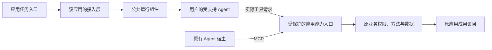

# 应用自带 Agent 接入产品与规范草案

日期：2026-11-13。版本：product draft 0.3。状态：独立项目的产品规格；配套规范已补齐文档级规则，尚无对应公共实现或互通验收。

本文明确“做成什么、谁使用、怎样判断产品完成”。用户已确认独立成项及从青凝实践提炼的方向；2026-11-13 明确规范与 SDK 分离；本轮继续只补后台受托、结构化保证及主任务限制的通用规则，并独立评审，不开发。

[接入规范](docs/general-integration-contract.md)是语言与实现无关的接入义务唯一维护入口；本文保留产品目标与交付验收，[SDK 技术设计](docs/sdk-and-qingning-integration-design.md)只是一种参考实现。应用可不使用该 SDK 而按规范接入，其他实现不必采用 Node/TypeScript、青凝接口或存储布局。具体包、函数名、首发组合和分发选择不定义规范本身。本文摘要不得削弱规范或既有产品目标；“必须”是目标要求，不代表已经实现。

## 1 产品定位与可观察目标

制定可独立实现的应用与 Agent 接入规范，并提供可复用的参考组件，使每位最终用户能够连接自己拥有或控制的受支持 Agent，使用应用材料、调用获准方法，并在原应用取得真实成果。

“自己的 Agent”分为原生安装和登录、个人配置、具体会话三个层次，分别声明支持。共享用户登录不代表自动加载全部插件、记忆或历史，应用专属新会话与复用已有会话也不是同一能力。

最小完整路径是：

> 应用作者完成接入并交付 → 最终用户连接自己的 Agent → 建立可撤销的身份与授权关系 → 提供任务与获准材料 → Agent 请求应用方法 → 原业务接口校验并执行 → 结果持久化或产出展示 → 用户从原入口继续使用。

纯对话和只读分析可以在完整产出交付后结束；有保存、修改或外部效果的目标，必须以原应用确认的真实结果及必要读回为完成条件。连接成功、进程退出或模型说“已完成”不单独证明业务成功。

## 2 使用者与两种入口

| 参与者 | 要做什么 | 从本项目获得什么 |
| --- | --- | --- |
| 个人应用创建者、应用开发者或维护者 | 提供上下文和原有业务方法，接可信身份、界面、授权与读回，交付应用更新 | 可独立实现的接入约定、可选参考组件、明确的兼容与恢复规则 |
| 最终应用使用者 | 选择本机或远端受支持环境，完成原生登录、连接和授权，发任务、处理必要交互并查看成果 | 在已接入应用中复用自己的 Agent，无需编写工具 schema 或复制登录令牌到业务表单 |
| 组件维护者和适配贡献者 | 维护公共接口、引擎适配、能力差异、兼容验收与接入说明 | 同一份实现和可复核的消费者反馈 |

个人创建者可以同时承担前两种角色。模板、插件和 AI 应用生成工具可辅助完成开发者接入，不能代替应用作者的授权与最终验收。

| 入口 | 会话由谁控制 | 应用接什么 | 用户怎样完成 |
| --- | --- | --- | --- |
| A 应用内使用自己的 Agent | 应用控制其管理的会话，具体历史仍归原生引擎 | 运行组件、任务和上下文、事件/内容、工具及交互界面 | 在业务按钮或对话中发起，成果回到原应用 |
| B 原有 Agent 操作应用 | 原有 Agent 宿主 | 受保护的 MCP 应用方法与资源、授权说明、结果读取 | 在原宿主发起，通过应用原接口产生并查看成果 |

B 可以只用应用 MCP 服务和已有宿主，不强制安装控制整个 Agent 的第二 daemon，也不要求向应用镜像整个原对话。A/B 共享同一业务方法和原业务 owner。

## 3 拟交付的产物

以下是同一产品的职责和验收出口，不要求按行建立独立软件包或服务。

| 产物 | 内容 | 可使用的完成标准 |
| --- | --- | --- |
| 参考 SDK / 公共运行组件 | 引擎发现和兼容检查、创建/恢复会话、轮次控制、完整可见输出、错误、取消和能力协商 | 真实应用从公开入口调用受支持引擎，能连续使用并处理失败；日志不冒充最终内容 |
| 应用能力接入 | 对应用 MCP 或现有受控工具桥的适配，保留输入输出及原业务授权 | 实际调用原方法并取得真实结果，声明的结构化内容不会在桥中丢失 |
| 接入规范与符合性说明 | 独立于 SDK 的义务、标准绑定、能力声明、授权、防重、恢复、连接与诊断隐私 | 独立接入者据规范与公开绑定说明实现同一真实场景，差异、不支持项及验收证据可核对 |
| 青凝参考接入 | 青凝原 CLI、桌面和后台流程通过公开组件运行，业务规则留在青凝 | 青凝使用同一组件版本完成原有路径，保留登录、设备、会话和业务兼容 |
| 不同领域的参考应用 | 例如资料库的“读取材料、保存笔记、读回笔记” | 不依赖青凝账号或数据模型，不复制 daemon，使用同一公开实现完成操作 |

青凝和第二应用完成同源接入，是参考 SDK 可用性与复用性的最小检验，不自动证明规范可独立实现。规范还须通过不依赖该 SDK 私有代码或隐藏约定的独立接入与语义反例验证，见[规范第 14 节](docs/general-integration-contract.md#14-符合性验收与独立实现)。两款应用不是市场统计门槛；第二真实消费者、独立接入与运行验收目前均未落实，示例不冒充外部采用。

第一项可先作为运行库交付。仅运行库通过时只报告该范围完成，完整的发布后连接、A/B、远端和交互目标继续保留为待验收，不能以较窄交付更改产品最终目标。

## 4 运行位置与连接责任

应用位置与 Agent 位置分别记录。公共核心是可嵌入组件，调用方必须是可信应用宿主；它本身不自动提供公网多用户网络服务。

| 组合 | 需要的实际链路 | 草案处理 |
| --- | --- | --- |
| 本地/桌面应用 → 用户本机 Agent | 应用随附运行组件，或连接用户已授权的受支持运行服务 | 优先验证的实现路径，保持受控进程和凭证边界 |
| 发布的 HTTPS 应用 → 用户本机 Agent | 用户机器运行连接器/服务，建立到应用的受认证出站链路，或经验证的浏览器直连方式 | 连接器交付及逐用户配对必须单独闭合；仅安装服务端 SDK 不算完成 |
| 应用 → 用户自有远端机器 | 远端受支持运行服务、身份与网络连接、工具回调及审批入口 | 按具体组合验证；远端交互终端不自动等于无人值守服务 |
| 应用 → 已有远端 Agent 服务 | 明确其协议、认证、会话、工具和事件能力 | 通过已验证适配器接入，不承诺任意 URL 即用 |
| 本地应用 → 远端 Agent | 控制通道与远端可达的应用能力入口，或已验证反向桥 | MCP 配置地址必须从实际执行机器可达；远端 localhost 不是用户电脑 |
| 原宿主 → 应用（B） | 宿主支持的 MCP 传输和应用受保护入口 | 复用原生连接；本地与远端各自验证 |

跨网络链路必须校验实际应用和用户、权限范围、撤权及通道来源。模型和不可信网页不得提交任意环境变量、可执行命令、凭证目录或未经校验的目标地址来扩大权限。若采用已有连接层，明确它与应用分别持有哪些身份和状态，避免重复配对或竞争状态 owner。

## 5 职责与持久状态

“应用接入层”指应用将自己的身份、任务、上下文、业务方法与公共组件接起来的代码，原先称“宿主适配”。青凝接入层只是其中一个实现。



应用持有业务身份、对象权限、事务、结果和业务防重；原生 Agent 持有其真实会话历史。公共组件只持有所需运行句柄、会话映射和有明确消费者的最小恢复信息。显示名称、应用 ID、session ID 或工具参数都不是授权凭据。

可信运行绑定从已验证应用上下文建立，至少能区分应用、调用主体、工作范围、引擎与认证配置。远端绑定来自受认证通道，进程内绑定来自可信宿主；不能把浏览器传来的同名 JSON 字段当成已认证身份。创建、恢复、工具调用，以及输出订阅、查询、重连、结果/历史/产物读取与交付均复核当前归属和有效授权。长连接必须能随授权失效停止向失权接收方交付，不能只在建立连接时检查一次。

注销、账号或工作范围切换、撤权时，应用隔离或清除旧主体的展示与缓存，阻断旧认证上下文的迟到更新，不能把甲的输出提交到乙的界面。沿用现有可信上下文和撤权机制，不要求每个字符查数据库，也不因此删除原 owner 合法保留的历史；后续读取仍需有效授权。

本稿不新增统一账号库、业务数据库、中央凭证库或第二套 transcript。需要外部连接授权时优先复用实际连接层，授权记录必须有唯一 owner、实际生产者和消费者后才能设计持久化。

## 6 应用提供的数据与方法

详细语义沿用[通用接入约定第 3、4、6 节](docs/general-integration-contract.md#3-应用提供什么数据)，以下定义最小输入和消费关系。

| 输入 | 应用提供的内容 | 接入要求 |
| --- | --- | --- |
| 任务 | 用户要求、必要约束、期望得到的内容或业务结果 | 任务指令与不可信业务材料区分；任务可由按钮发起 |
| 上下文 | 获准文本、受支持内容块、对象引用与必要版本信息 | 说明全文/摘要/截断/分页，按需提供受保护的继续读取入口 |
| 可见方法 | 名称、描述、输入 schema、必要输出 schema、只读/写入说明 | 优先通过现有 MCP 发现，应用执行前真正校验；方法描述不授予权限 |
| 方法结果 | 实际数据或错误、声明的结构化结果、所需业务回执 | 保留标准结果字段，模型候选数据与业务提交事实分别消费 |
| 交互决策 | 用户对当前批准请求的选择或补充信息 | 绑定具体主体、会话、请求和操作范围，过期/重发/撤权后不能误用 |
| 受信运行设置 | 选中的已安装适配器、受控工作目录、认证 profile、批准策略 | 由可信接入层和实际用户授权产生，不能直接透传模型输入 |

应用无需定义青凝命令。资源可以通过已有读取工具提供，有真实需求时再使用 MCP resources/prompts，不为形式完整另建资源中心。

Agent 取得方法描述和调用途径，实际函数、权限判断和事务继续在应用执行端。ACP 工具状态通知用于展示，不能被接入层再次解释为业务执行请求，造成双执行。

## 7 Agent 和应用执行端分别返回什么

| 返回语义 | 来自谁 | 消费者和限制 |
| --- | --- | --- |
| 用户可见文本与内容 | Agent 实际输出 | A 交付应用，B 交付原宿主；不泄露内部推理，不把截断日志当完整结果 |
| 结构化候选产出 | Agent | 应用按声明 schema 校验后使用；仍不证明已经保存 |
| 方法调用请求 | Agent 经 MCP 或受控工具通道 | 原业务执行端验证后执行；调用 ID 不自动充当业务幂等键 |
| 进展、工具状态和轮次终态 | 运行适配器根据原生事件 | 应用或宿主展示；轮次结束、工具结束与业务提交是不同事实 |
| 人工批准或补充信息请求 | 原生引擎/受支持协议 | 由有权控制该交互的应用或宿主处理；不支持所需交互时不能默认同意 |
| 数据与业务回执 | 原应用方法 | 证明原 owner 实际确认的数据或效果，可附原应用查询/读回引用 |
| 模型与用量 | 引擎实际报告 | 没有报告时保持未知；不能依据缺少用量推断任务未执行 |

文本、结构化内容和产物引用按实际支持保真传递；接收方还需取得引用内容的真实访问权。工具结果复用对应 MCP 版本的 `content`、`structuredContent`、`isError` 和 `outputSchema`，不强制所有方法增加统一业务回执字段。

只读结果无需伪造“已提交”。写入目标应从原业务回执与读回确认实际结果；模型的“已保存”文本只供显示，不能触发成功状态。

## 8 接入规范与 SDK 的分离

规范固定的是参与方的义务和可观察语义，不固定函数签名。A 必须把任务与获准内容送入受控会话、交付所需完整输出并报告真实控制结果；B 必须让获准工具请求到达原业务执行端并保留结果。写入、批准、恢复、网络及多来源材料按照实际任务分别适用，安全义务不能变成可选项。

实现可使用参考 SDK、官方协议 SDK 或自己的适配层。任何实现均须给出[规范第 11 节](docs/general-integration-contract.md#11-最低符合性与能力声明)所要求的版本、能力及实际绑定；只接 B 无需创建应用运行会话。输入输出优先沿用选定标准字段，不为统一表象增加平行 RPC、业务回执或状态库。

`inspectAgents`、`openSession`、`startTurn`、OutputSink、`/host` 等仅是[Node/TypeScript 参考设计](docs/sdk-and-qingning-integration-design.md#3-主入口的最小接口)。这些名称、同包组织和青凝兼容接口都不是独立实现的符合性条件，也不构成已发布 API。参考实现与规范冲突时修正实现，不通过实现便利缩减目标。

本轮补充的通用规则集中在规范的[结构化保证](docs/general-integration-contract.md#51-结构化产出的保证与校验)、[受托决定](docs/general-integration-contract.md#71-后台受托发起与交互决定)与[运行限制](docs/general-integration-contract.md#72-主任务时限与预算的承诺边界)：有效策略不伪称真人，原生约束与宿主校验不混同，硬限制/协作停止/观测分开声明。任务必需能力缺失先拒绝，不要求所有引擎具备所有模式。

具体 API、语言/解析器、进程/超时机制和原生参数由实现与绑定选择；委托发放、维护周期、业务预算、候选验收与启用继续由消费者负责。ServerAgent 的期望用于检验通用语义，不把其业务协议或四项完整接入支持变成 Bridge 已交付能力。

## 9 能力、版本和兼容声明

能力按实际组合记录，最少包括运行环境、组件/适配器版本、引擎版本、协议版本、认证配置类别和验证证据。发现程序、文档声明、源码确认与真实流程通过分别标记；未经验证不能写成正式支持。

必须区分完整用户输出、内容类型、方法调用、结构化工具结果、人工批准、补充信息、取消、会话恢复与事件重放。它们各自声明，不用“支持 ACP”或“支持 MCP”概括全部能力。

所需能力缺失时拒绝或明确等待选择；可选内容降级必须说明丢失什么并取得适当同意。强制安全能力不允许通过同意丢弃，不能以用户接受部分显示为由绕过权限或业务防重。

SDK 接口版本、网络协议版本、引擎版本和青凝应用版本各自记录。新增可选字段不能改变旧字段语义；不兼容变化需标明范围、适配路径和原消费者回归。具体包版本规则与支持周期在首个可运行包前确定。

截至本稿，Codex、Claude Code、DeepSeek Harness 是优先核验对象，尚无本项目正式兼容矩阵。2026-11-04 的青凝能力差异见[抽取评估](docs/extraction-assessment.md)，本次没有将它重验为 2026-11-12 当前源码或运行状态。DeepSeek Harness 与仅调用 DeepSeek 模型 API 分别处理。

## 10 权限、并发、停止与恢复

### 权限和跨应用材料

连接绑定应用、主体和授权范围，运行前及实际方法执行时复核当前权限。材料、工具描述与模型文本均不能扩权。A 在其管理的原生文件/终端/网络路径落实承诺限制；B 的这些路径由原宿主管理，应用 MCP 授权只约束自身服务。

多应用共用会话时，读取 A 和修改 B 的单独授权不自动允许把 A 的材料传给 B。实际宿主按用户授权的目的、材料范围和接收方控制披露，范围包括上下文聚合、工具参数、回答文本/事件流、结构化产出、产物和历史读取；明确授权的跨服务任务可复用该授权。由某应用发起任务不等于允许将整段原会话或其他服务材料返回该应用。即使接收主体正确，材料也必须获准向该接收方披露。

可使用范围相符的专属会话或已验证宿主机制落实上述规则。不能可靠控制混合来源输出时，相关共享会话或多服务敏感组合不得声明满足该隐私目标，应使用符合授权范围的运行组合或拒绝该组合。不能只补工具参数检查就宣称输出隔离，也不能将责任推给无法识别材料来源的目标服务。本稿不预设新增通用内容过滤或来源数据库。

批准属于真实执行前的具体决定。应用业务权限校验不被批准窗口替代，原生执行限制也不被 MCP scope 替代。撤权后新调用应拒绝，已有连接须重新校验或失效；已产生效果和在途操作需报告真实情况，不假称撤权必定杀死宿主或回滚数据。

### 会话与并发

A 默认使用应用专属会话，绑定主体、工作范围、引擎和认证 profile。切换这些关键条件时验证新归属，不能直接复用裸原生 ID。B 的会话由原宿主管理，应用只检查自身调用归属；不能要求它创建或接管原对话。同一原生会话按实际支持串行或排队；排队不代替原业务事务、版本约束和并发防重。

### 写入、防重与未知结果

写方法沿用[通用接入约定第 4 节](docs/general-integration-contract.md#4-应用提供什么方法)的准入要求，A、B 都适用：由原业务 owner 的已验证幂等、唯一或版本约束，或可信上下文中稳定业务关联，原子防止同一业务请求重复生效。RPC ID、轮次 ID、会话 ID 和 IPC ID 不自动成为该关联，也不能依赖模型记忆生成。

重复请求可返回原结果或拒绝，能够防重不自动等于能够安全重试。相同关联绑定主体、方法、目标和输入，变更输入不能复用。关联必须在首次效果前建立并在承诺范围内保留；遗失、过期或效果不可核对时，拒绝相应重试并核对，不重新签发关联绕过防重。能力不足的方法不能通过写入准入。

断线、超时、无用量或进程退出均不能证明未执行。取消请求与停止确认分别报告；已提交内容不因停止而撤销。恢复先核对原生会话与应用效果，无法核对时保留未知并给出实际可行的原应用核对入口，不伪造通用查询服务。

此前评估指出 `runEngineAttempt` 存在基于“无 usage＋进程退出”的重发条件，尚未复现业务重复。本项目不得沿用该条件作为安全证明；后续抽取前需验证“工具已执行、完成事件尚未收到”的反例及原 owner 的实际处理。

## 11 复用哪些协议，补充哪些约定

本修订采用 ACP v1 与 MCP 2026-07-28 作为规范标准绑定基线；现代 MCP 的逐请求版本/能力与多轮接续、ACP 初始化及会话分别按[规范第 8 节](docs/general-integration-contract.md#8-哪些复用标准-哪些需要补充)维护。旧版或其他原生绑定须明确版本及等价语义；实际引擎/宿主组合仍需验证，文档可访问不等于实现互通。

| 交互 | 复用来源 | 本项目补充的接入约定 |
| --- | --- | --- |
| 会话、轮次、内容和状态 | [ACP session setup](https://agentclientprotocol.com/protocol/v1/session-setup)、[prompt turn](https://agentclientprotocol.com/protocol/v1/prompt-turn)，或引擎原生接口 | 应用范围绑定、完整内容交付、版本/profile 差异和恢复结果的准确呈现 |
| 方法发现、参数与真实结果 | [MCP tools](https://modelcontextprotocol.io/specification/2026-07-28/server/tools)，资源按需复用 MCP | 不搬领域对象，保留 schema/结构化结果、业务权限、防重与读回 |
| 人工批准与补充信息 | [ACP tool permissions](https://agentclientprotocol.com/protocol/v1/tool-calls)、[ACP elicitation](https://agentclientprotocol.com/protocol/v1/elicitation)及宿主支持接口 | 请求绑定、实际决定方、不支持时的行为；逐版本协商 |
| 应用 MCP 服务的网络授权 | [MCP authorization](https://modelcontextprotocol.io/specification/2026-07-28/basic/authorization)及应用现有身份体系 | 实际用户与对象权限、撤权、可信调用上下文，不创建替代业务身份 |
| 前端事件与展示 | 可选 [AG-UI 映射](https://docs.ag-ui.com/concepts/architecture)或原应用事件 | 输出保真、交互界面和未知状态，避免另一套竞争事件协议 |
| 用户本机/远端连接 | 已验证连接服务或现有出站链路 | 每应用每用户配对、通道与运行身份、安装/撤权/恢复的可验证流程 |

[ACP v1 传输说明](https://agentclientprotocol.com/protocol/v1/transports)目前定义 stdio，并允许有明确文档的自定义传输；远端 Streamable HTTP 另属提案。不能将某项目的 WebSocket 实现视作全部 ACP Agent 的标准远端接口。

本稿不定义新的 JSON-RPC 方言或全量网络协议。必要缺失语义先通过已有标准扩展/兼容绑定表达并检验互通；本项目的应用接入规范不因此扩展成新的通用传输协议。

## 12 新应用、已有应用与发布后使用流程

### 新应用

开发者先确定一条真实任务和结果位置，复用应用身份与业务方法；接公共运行组件和/或受保护 MCP 服务，接通任务、内容、人工交互和成果读回，再随应用交付所需运行组件或已验证连接方式。只需 B 的应用按 B 接入，不强迫新增应用内对话。

### 已有应用

开发者找到可修改的源码或插件入口，把现有读写方法接为工具，保留原业务授权和事务。接 A 时在现有页面增加任务与状态入口；只接 B 时补受保护 MCP 服务、连接/授权说明与原有成果入口，不要求新增应用发任务界面。验证旧功能与 Agent 写入都能从原页面读回，再按原发布机制交付。已有 MCP 可以直接复用；没有扩展入口的封闭应用不能承诺零改动完整接入。

### 发布后最终用户

1. A 从应用连接入口选择执行机器/服务和 Agent，明确材料和操作；B 从应用 MCP 说明在原宿主连接应用端点，选择其获准材料和操作，原宿主继续管理自己的 Agent。
2. 已有可用安装登录直接复用。A 所需运行服务由应用随附或清楚引导，避免重复安装；B 按原宿主支持方式连接服务，不要求另装控制整个 Agent 的运行服务。真实模型探测由用户主动触发并说明会消耗其用量。
3. A 按所选链路建立应用、用户与受控机器/运行服务绑定；B 以 MCP 支持方式绑定应用端点、调用主体和授权范围，不以登记或控制原宿主机器作为普通 MCP 互通前提。用户在可信界面核对来源和范围，有查看与撤销入口。授权沿用应用账号和原生 Agent 认证，首版不预设额外云账号。
4. A 在原应用发任务，B 在原宿主发任务；所选材料和方法均经过当前授权检查。需要批准/补充时在实际控制交互的一端处理。
5. 产出可见；写入由原方法提交并从原应用读回。重新打开应用仍能找到持久成果。
6. 用户继续追问、停止或断开。遇到断线与未知效果，先核对原操作再恢复；实际不支持恢复时说明范围，选择新会话不能冒充原历史恢复。

这些是目标流程，具体本机连接器安装包和远端配对 UI 尚未实现。运行库集成完成不能单独标记全部步骤通过。

## 13 领域示例与端到端完成条件

资料库的任务是“比较选中材料，保存阅读笔记”。应用提供读取材料、保存笔记和读取笔记方法。方法 schema 与笔记对象由资料库定义；需要写入时以可信绑定、版本或稳定业务关联通过原 owner 准入。

```text
用户选择材料 → 应用确认有权读取 → Agent 取得获准内容
→ Agent 请求保存笔记 → 原资料库校验并原子执行/拒绝重复
→ 返回真实结果与笔记引用 → 应用读回 → 展示已保存成果
```

若保存后响应丢失，不能因 Agent 没收到成功就新建第二份笔记。按原效果核对入口或稳定业务关联确认，缺少证据时保持未知。图片标签、任务处理和青凝消息可使用各自方法遵守同一规则，不要求共享“笔记”模型。

完整兼容组合的验收应覆盖正常连续任务、所需内容/工具、批准和拒绝、身份切换/越权/撤权、并发和重复请求、取消/断线/重启、未知效果，以及原应用权威读回。没有写入目标的任务按其完整产出验收，不要求伪造提交；已有写入目标不能降级为只读演示。

输出边界还须验证两个独立负例：甲发起私密任务后切换乙或撤权，旧订阅、结果查询、缓存与迟到事件均不能向失权主体交付；接收者仍为应用 A，但混合来源会话中的材料未经授权向 A 披露时，不能经回答流、结构化结果、产物或历史读取绕过范围控制。合法授权的输出与跨服务任务仍须可用，B 不为通过这些检查而向应用暴露整个原对话。

青凝使用同一公开组件的兼容验收还包括原登录、设备和会话映射，原 CLI/桌面入口及升级/回退。首步保持旧配置路径和原生历史 owner；如确需持久迁移，另行明确转换、在途操作和回退。同一运行配置/服务实例只有一个有效后台进程控制者，避免新旧组件同时抢占；不同应用或 profile 的隔离实例仍分别管理。

## 14 本轮规范补齐与后续边界

此前 draft 0.2 已补齐实现无关的符合性、写入/恢复、标准绑定、连接/诊断安全与独立验收；本轮 draft 0.3 进一步补受托决定、结构化保证和主任务限制。SDK API、青凝代码归属与历史来源仍留在实现设计。定义规则不等于实现这些规则，也不等于实际部署组合已获兼容认证。

下一条运行验证路径仍是：真实应用接受创建/保存意图 → 可信入口保留稳定业务关联或验证原生约束 → A/B 工具通道 → 原业务原子执行 → 响应丢失后的核对与防重 → 原界面读回。它用于验证规范能否指导参考 SDK 和独立接入达到同一语义，不先建设新操作库或连接平台。当前只做文档与独立评审，未开始该运行工作。

正式命名、软件包、Node/API 选型、首发实际引擎/宿主/连接产品、第二真实消费者、独立接入执行证据、许可与发布渠道仍待落实。各实际绑定必须按已定义的规范填写并运行验收，不能将未支持项写成兼容，也不以更宽权限或缩减写入目标补齐。

## 15 文档复核记录

2026-11-12 完成一次独立文档复核，范围是 A/B 与本机/远端目标、原 owner、权限/防重语义及复制后的状态说明。发现两处范围表述并已修正：应用专属会话仅默认适用于 A，B 保留原宿主会话；后台进程唯一性按同一运行配置/服务实例约束，允许不同用户和 profile 的隔离实例分别运行。

原有 7 份文件在复制时逐文件比对一致；原目录的 7 份文档内容保持不变。新目录新增本 SPEC，调整 README 与两份文档的衔接说明，其余 4 份历史文档保持原样。8 份 Markdown 的本地链接、标题锚点、引用与代码围栏检查通过。

上述结果只证明文档复制、规格与范围核对，不是 SDK、引擎、运行平台或实际应用兼容验收。2026-11-02 的原三轮评审记录继续只适用于当时版本。

后续多角色评审、裁判裁决、修订与每轮复核结果集中记录在[2026-11-12 SPEC 评审记录](docs/reviews/2026-11-12-spec-review.md)，不将文档问题关闭作为运行验收通过。

2026-11-13 修订已将规范与参考实现分离，并完成独立角色审查和裁判复核；确认的 2 项 P2 文档问题已修订关闭，未发现剩余实质问题。规范规则、文档检查及未执行运行验收范围见[本轮补齐与独立评审记录](docs/reviews/2026-11-13-normative-gap-review.md)。2026-11-12 的结论与摘要仅适用于旧受审版本，不自动覆盖本修订。

本轮 draft 0.3 已完成两位独立角色审查和最终裁判复核，未发现需修订的实质文档问题；规则、检查与未执行运行边界集中在[受托与产出/限制规则评审](docs/reviews/2026-11-13-runtime-rules-review.md)；上面的 draft 0.2 关闭记录保持历史含义，不自动作为本修订通过依据。
