# 从青凝 bot 提炼公共 Agent 接入组件的可行性评估

日期：2026-11-04。状态：源码评估与边界建议，未开始抽取、开发或发布。

## 结论与建议

**可以从青凝提炼出有实际来源的公共组件，优先范围是引擎运行、会话控制及必要的受控工具传输。青凝继续保留业务宿主，通过公开接口使用同一份实现。** 当前不建议整体搬出 daemon、配对数据库与业务调度器，也不建议立即用其他项目替换整条现有链路。

这使“从青凝抽取共享组件”成为下一阶段的主要候选。此前研究发现的现成项目继续作为复用、贡献和对照对象；存在竞品不排除提炼已有资产的价值，但已有代码也不证明完整通用产品已经成熟。公开组件的维护成本、第二应用的接入收益及对青凝的传播收益尚未验证。

当前 CLI、桌面端和后台服务已经复用同一份运行源码。因此抽取的价值不能表述为消除现有两份实现，而是建立独立可用的公开接口、清晰的宿主边界和可追踪版本。它同时增加接口兼容、发布和外部支持成本。

## 核查基线与证据范围

- 仓库为 ResearchStudio 下的 `青凝bot`，HEAD 为 `803f4b782ba664d388c05817e27944880daa5e09`。所核源码没有未提交修改；无关未跟踪文件保持原样。
- 先用 CodeGraph 定位调用者，再读取索引过期的关键源码。以下源码位置均相对该仓库，未来迁出文档时保留版本和来源定位即可，不要求其他应用使用当前电脑目录。
- 只读源码、测试定义、构建配置和已有验收记录。未运行测试、构建、安装、模型、数据库或线上服务，也未读取实际登录凭证与用户配置。
- 2026-11-02 的[协议来源事实基线](sdk-and-qingning-integration-design.md#15-2026-11-02-历史来源基线)保留其历史含义；本报告补充当前版本的抽取判断，不把旧行号或历史验收当成本轮运行结果。

## 当前已经实现的用户路径

青凝已有从应用发布后连接用户机器到业务结果的源码链路，并非只有开发者本机调用模型：

1. 青凝用户在当前工作区进入“我 → 计算机”，由具有相应角色的人添加机器。桌面端通过可信 Electron IPC 调用随附 CLI，命令行也有配对入口。
2. CLI 在用户机器检查引擎，向青凝服务配对，私有保存设备身份。后台 daemon 出站连接青凝 HTTP/SSE 服务，取得分配给该机器的 Agent。
3. 每个 Agent 取得受当前分配关系约束的短期身份，接收业务工作，启动或恢复本机引擎会话。
4. Agent 经固定 MCP/CLI 工具及本机 IPC 请求业务操作。daemon 持有身份、服务地址和令牌，模型不能通过参数改写这些信息。
5. 青凝服务再次验证身份与实时分配，原业务命令在自己的权限和事务边界执行。结果持久化在原业务数据中，应用从原入口读回。

同一 daemon 可部署在用户控制且能访问青凝服务的远端机器。源码具备这类出站拓扑，但它不等于“填入任意远端 Agent URL 都能接入”，也不证明所有系统、引擎和远端审批都通过验收。

现有参与单位主要是青凝工作区与其 Agent 分配。它与长期目标中“任意应用内每位普通用户独立授权自己的 Agent”存在语义差异，不能直接更换字段名称便宣称已经通用。

## 抽取边界

以下是职责划分，不是要求建立多个软件包、服务或数据库。包名、接口形状与分发方式尚未冻结。

| 部分 | 现状与实际消费者 | 处理建议 |
| --- | --- | --- |
| 引擎发现、版本与模型检查、原生 adapter、进程启动/停止、错误分类 | `engine.ts` 仅直接依赖 Node 和少量本地辅助模块；真实消费者是 `AgentRunner` 与桌面连接前检查 | 公共核心候选。先拆业务引导内容与受信运行配置，保留现有引擎限制和测试 |
| 原生会话控制、会话指针、恢复辅助 | 已有 `EngineSession`、`EngineSessionStore`、`runWithSessionRecovery`；原生历史仍由各引擎持有 | 可以提炼机制。宿主提供可信的应用/用户/引擎作用域，不另建 transcript owner，不把 session ID 当授权凭证 |
| `RuntimeCliBroker` 文件 IPC | 已接受 `invoke(argv, signal)` 回调，具备原子 claim、输入限制、拒绝链接和受控响应 | 适合提炼受控传输机制；保留安全性质。它仍是 argv 请求桥，不自动成为通用工具目录 |
| MCP/CLI shim、方法描述、工具结果 | 当前固定 `cumora`、`cli(argv)` 和文本结果；实际调用回到青凝 HTTP API | 需通用化。应用提供获准方法与实际执行者，青凝提供兼容适配。不能给浏览器任意程序、环境或身份注入权 |
| Persona、任务和上下文组装、工作输入、用量上报 | daemon 导入青凝任务指南、消息、分诊、agenda、组织及聊天规则 | 留青凝宿主，调用公共核心；其他应用使用自己的工作输入和结果消费者 |
| 配对、设备注册、Agent placement、业务身份和写入 | SQL、JWT、companies/computers/participants 与业务事务由青凝服务持有 | 留青凝原 owner。公共组件不要求其他应用复制这些表，也不建立竞争授权服务 |
| CLI、Electron、后台自启 | 已有独立 CLI bundle，终端和桌面消费同源实现；仅有 bin，没有公开 library exports | 青凝入口继续保留，改为依赖公共核心。首步不增加另一套常驻服务、安装器和更新器 |

建议的依赖方向为：

```mermaid
flowchart TB
  Q[青凝 CLI / 桌面入口] --> QA[青凝宿主适配]
  QA --> CORE[公共运行核心与受控工具传输]
  OTHER[其他应用的宿主适配] --> CORE
  CORE --> ENGINE[用户的受支持 Agent 引擎]
  QA --> QOWNER[青凝原身份、业务方法与持久结果]
  OTHER --> OWNER[其他应用自己的身份、业务方法与持久结果]
```

图中的其他应用是待落实的第二消费者，不是已经完成接入的事实。青凝 CLI、Electron 与后台服务属于同一产品的不同渠道，不能充当多个独立应用的通用性证明。

## 必须拆清的耦合与能力差异

### 应用身份和本机执行权限

当前 `/api/computers` 配对入口要求工作区 owner/admin；配对码是持久的 company 令牌，设备与 Agent 分配也由青凝表维护。这套机制服务现有工作区管理，不是任意第三方应用的逐用户、逐应用授权 SDK。桌面连接重试与旧 CLI 按 hostname 重连还有不同兼容语义，不能合并后静默改变。

青凝已有每请求 JWT 与 live assignment 检查、分配代次、控制流重新授权和业务事务内复核。抽取必须保留这些保护，不能将权限耦合当成“删掉即可通用”的代码。它们仍由青凝适配层与业务 owner 承担；其他应用接入自己的可信身份和权限校验。

Claude/Codex 有宿主约束的运行配置与版本检查；其他引擎采用显式兼容授权，能力并不等价。模型进程和应用令牌的隔离、固定可信可执行入口、IPC 文件约束也必须保留。当前桌面桥只接受青凝自己的可信页面，不能直接放宽 origin 作为通用公网网页连接器。

### 返回内容、交互与业务结果

`EngineRunResult` 当前没有统一最终文本字段，公共会话接口主要提供日志和用量回调。现有青凝流程依赖业务工具提交回复和成果；这可以完成其当前业务路径，却不足以直接承诺任意应用获得完整聊天文本、类型事件和多模态结果。

公共接口也没有统一的人工批准/补充信息回调。Claude、Codex 的受限执行策略与 DSH 的兼容模式不能混称为同一交互能力。需要应用内人工批准或完整文本结果时，应按实际消费者补齐，是新增行为，不能记录为纯搬文件。

HTTP `/runtime/cli` 的 `ok/text/exitCode/sideEffects` 在 daemon 中收窄为 `text/exitCode`，MCP 再返回文本。原业务结果没有因此消失，但公共调用方尚不能取得保真的结构化回执。后续应由原 owner 返回和查询真实结果，避免建立另一套“模型声称已执行”的业务状态。

### 会话、个人配置和失败恢复

复用原生登录、复用全部个人配置和复用原有会话是不同能力。Claude 只恢复筛选后的个人设置；Codex 使用独立 runtime 配置与历史空间；DSH 使用 ACP，但当前注入的 `mcpServers` 为空，主任务兼容模式自动选择 allow-once，中途 steer 不支持。抽取不能自动承诺所有插件、记忆、审批和会话能力一致。

`EngineSessionStore` 只保存原生会话指针，按引擎和 profile 区分，并非业务结果数据库。青凝的工作恢复还依赖 durable inbox、原生引擎与原业务读回；IPC request ID 不是业务幂等键，启动时清理旧 IPC 也不是未知效果恢复。

**有一项必须进一步验证的重发风险。** `session-recovery.ts` 只在明确缺失会话时重试；但真实调用链的 `daemon.ts:2082–2101` 还会在“出错、没有 usage、持久进程已退出”时转为 one-shot 重发。没有 usage 不能证明工具尚未产生效果。本轮确认了源码条件，未复现重复业务结果，不将其写成已证实事故。现有 recovery helper 测试不能单独证明这条完整链安全。

后续需先验证“工具已经执行，但完成/usage 事件返回前断链”的反例，并按证据处理真实 owner 中的问题。不能因要求行为保持就将风险包装成已通过的通用重试语义，也不能用只读演示代替写入验收。

## 状态、兼容和交付约束

| 状态或权限 | 当前权威来源 | 抽取时应保持 |
| --- | --- | --- |
| 应用账号、对象权限、配对与设备归属、业务结果 | 青凝后端及原业务事务 | 原路径继续有效；公共核心不复制业务表或另发可竞争的身份 |
| 原生认证与 transcript | 各 Agent 的原生存储及现有受控 runtime 配置 | 不复制凭证为中央库，不整体导入个人目录；支持能力如实列明 |
| 设备配置、profile、会话指针 | 当前 `.cumora` 私有目录及现有 session store | 首步由青凝适配层继续使用原路径与命名空间；不做纯改名式迁移 |
| 后台进程与系统服务 | 既有 daemon ownership、服务名与 supervisor | 单一控制者，禁止新旧版本同时抢占同一配置；更新与回退替换同一受控执行入口 |
| 界面连接状态 | 可信连接过程及青凝原 `/computers` 读回 | 不把成功 spawn 当连接成功，不在公共 UI 新建第二份设备事实 |

已有终端别名、固定 Node/CLI 分发、可信桌面输入、Linux AppImage 的持久运行组件和三系统 supervisor 都是可保留资产。Windows/Linux 有构建与测试代码，但已有验收记录仍留原生实机边界；历史 Mac 验收也不能外推当前所有引擎、所有应用或全部平台。

现有 README 中的旧 npm 用法不能证明已有可用公共分发渠道。独立包的源码、CLI 产物和青凝应用版本需要明确关联，禁止接入未知更新源或让公开包升级绕过青凝已锁定的兼容验证。

仓库声明 MIT，LICENSE 记录的原始版权名为 yetone。独立发包前还需核对实际抽取来源与 bundled 依赖的许可/署名覆盖，不能称作全部青凝原创。本轮只核元数据，不进行发布或完整来源审计。

## 方案比较与独立裁判结论

| 方案 | 对当前目标的作用 | 本轮判断 |
| --- | --- | --- |
| 提炼公共核心，青凝通过宿主适配继续使用 | 保留真实消费者与原业务 owner，使第二应用可独立接入同一实现 | 主要候选；需拆业务配置、补真实消费者所需的输出/工具边界，不能把仅运行库抽取称为完整产品 |
| 整体将 daemon/registry 改名开源 | 可以生成独立进程，但仍依赖青凝工作区、调度与后端契约 | 不适合作为第一步。若全部通用化，已是新增网络授权与工作流产品，远超行为保持抽取 |
| 直接切换到 agentd/Paseo 等上游 | 可能复用连接或运行能力 | 当前没有证明迁移青凝现有身份、历史、安全和交付的成本更低，不作为本轮首选；保留具体部件复用和上游贡献 |

独立运行、连接、交付角色分别取证，裁判重新读取关键调用链和既有 A/B 要求，支持第一种方向。裁判特别确认：已有 CLI 同源构建，不能虚报消除了双维护；仅抽 engine 不等于完整应用 SDK；工作区配对不等于逐用户应用授权；恢复辅助测试不覆盖内层 fallback 风险。

此结论是抽取方向判断，不是宣布安全验收、兼容验收或外部采用已经完成。若后续证据表明公开接口仍迫使其他应用复制青凝调度，需重新比较最小边界，而非继续扩大通用平台。

## 后续推进与完成标准

下一阶段的可观察目标是：**青凝通过公开组件保持原有能力；一个不同领域的应用通过同一入口使用自己的身份、材料和方法，完成真实业务操作并从原应用读回。** 第二应用尚未落实，示例只能验证可用性，不能冒充独立市场采用。

本轮不建立公共网络授权服务、共享 daemon 平台、Agent 市场或新协议。长期本机/远端、A/B 和各引擎目标不取消；某一运行库或本机组合通过时，只报告该范围完成，其余保持未验证。

进入实施后沿一条能力路径推进，避免按文件机械拆包：

1. 确认实际调用者、最终内容/工具结果消费者与宿主身份输入，补上上述重发条件的区分性验证。先明确哪些属于行为保持抽取，哪些属于新增接口行为。
2. 在原 owner 内划出公共核心，青凝业务适配继续使用原配置、会话、服务和授权；原 CLI 与桌面构建依赖该核心。先不迁移用户状态，不保留长期双实现。
3. 青凝从真实入口回归连接、选引擎、连续任务、受控业务写入和成果读回，验证升级与回退后原设备身份及会话归属仍正确。
4. 第二应用使用同一公开实现，自行提供数据和业务方法，完成对应路径；不能导入青凝公司/消息模型或另复制 daemon。再验证 B 入口、远端与其他承诺组合，逐组合记录能力与限制。

涉及进程执行、凭证、权限、会话及业务写入，验证按相应中高风险边界执行。复用现有引擎、IPC、配对、授权与原生配置测试，补足被实际变化影响的负例、重放、并发、撤权、取消、未知效果、升级兼容和权威读回。测试定义存在或纯对象测试通过不代替真实入口验收。

若确需改变持久布局，再单独明确转换、旧版本兼容、在途任务与回退，不能随接口改名隐式迁移。抽取本身不应新增业务状态 owner；每个新抽象都要有实际生产者、消费者和必要性。安全边界已有有效证据后，下一步应接通真实消费者，不反复增加同类包装与校验。

停止扩张的信号包括：公共包开始依赖青凝 DB/Redis 或业务对象；出现第二份会话/设备/授权状态；为每个应用复制适配器；只有青凝专用入口能用；连续新增接口却没有缩短第二应用的接入路径。遇到这些情况回查边界，保持完整验收，不能靠减少必要权限或写入要求让抽取表面成立。

**下一项具体工作**是以 `AgentRunner → EngineAdapter/EngineSession → 受控工具桥 → 原业务执行与读回` 为边界，形成可评审的最小公开接口与青凝适配设计，落实第二消费者；首先消除“无 usage 是否足以重试”的证据缺口。本轮继续遵守“先不开发”，代码抽取、真实模型运行与发布尚未开始。

## 当前源码与既有验证索引

下列测试仅阅读了定义，未在本轮执行。行号对应本报告 HEAD。表中 `engine.ts`、`daemon.ts`、`session-*.ts`、`codex-runtime.ts`、`computer-config.ts` 均位于 `server/src/agents/computer/`，`runtime/` 指 `server/src/agents/runtime/`，未重复写目录的引擎测试位于 `server/src/__tests__/`。

| 证据 | 源码位置 | 相关验证资产 |
| --- | --- | --- |
| 运行接口、浅层依赖及业务引导 | `server/src/agents/computer/engine.ts:25–36,683–701,792–870,1276–1317` | `server/src/__tests__/agents-computer-engine.test.ts`、`agents-computer-engine-failure.test.ts` |
| Claude/Codex 安全配置与 DSH 差异 | `engine.ts:1549–1625,1953–2006,3540,3834–3921`；`codex-runtime.ts:7–104` | 同目录 `agents-computer-codex-runtime.test.ts`、`agents-computer-codex-strict-config.test.ts`、`agents-computer-engine-dsh.test.ts` |
| 原生指针及恢复 | `session-store.ts:11–99`；`session-recovery.ts:10–24`；`daemon.ts:1944–1948,2068–2131` | `agents-computer-session-store.test.ts`、`agents-computer-session-recovery.test.ts`、`agents-computer-engine-hot-switch.test.ts`；内层未知效果重发需另验证 |
| 模型不持有应用令牌，IPC 受控 | `daemon.ts:1288–1360,1366–1548,2290–2327` | `server/src/__tests__/agent-computer-shim-output.test.ts` |
| 工作区配对、设备与 Agent 分配 | `server/src/api/router.ts:1315–1372,1558–1570`；`computer/registry.ts:374–390,461–609,753–788,1608–1616` | `server/src/__integration__/desktop-computer-connection.test.ts`、`computer-pairing-rotation.test.ts`、`computer-control-stream.test.ts` |
| 当前身份与原业务事务 | `runtime/server.ts:80–119,147–189`；`runtime/authorization.ts:23–48`；`runtime/cli-argv.ts:19–42`；`agents/cli.ts:2352–2403,2565–2632` | `server/src/__integration__/runtime-server.test.ts`、`runtime-aux-authorization.test.ts`；不可把局部 notice 幂等外推全部业务方法 |
| 独立 CLI 与同源构建 | `agent-cli/src/cli.ts:1–25`；`agent-cli/build.mjs:28–40`；`agent-cli/package.json`；`server/src/cli-bin.ts:16–39` | `server/src/__tests__/qingning-entry-compat.test.ts` |
| 桌面入口和权威读回 | `src/desktop/LocalComputerConnect.tsx:28–69`；`src/stores/computers.ts:36–98`；`computer/desktop-connect.ts:44–184`；`src/desktop/MeView.tsx:957,1387` | `tests/me-computer-connect-entry.test.ts`、`tests/local-computer-errors.test.ts`、桌面连接 integration |
| 可信产物、服务和配置兼容 | `electron/computer-connect.cjs:9–30,68–110,135–196`；`scripts/prepare-desktop-cli.cjs:25–71`；`computer-config.ts:7–23`；`daemon.ts:3973–3998,4229–4461` | `tests/electron-computer-connect.test.ts`、`agents-computer-desktop-config.test.ts`、`agents-computer-windows-service.test.ts`、`agents-computer-stop-paired-daemon.test.ts` |

历史平台证据位于青凝 `docs/acceptance/local-computer-connect-20261025/cross-platform-20261027.md` 与 `model-selection-repair-20261027.md`。本轮未复跑，也不把历史遗留问题未经核实写成当前缺陷。
