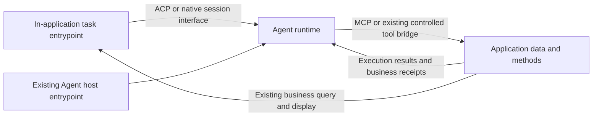

# Application–Agent Integration Specification Draft

English | [中文原文](general-integration-contract.md)

Both language editions belong to the same specification and use the same section numbers and version. This is a corresponding translation of the Chinese source. Resolve and correct translation discrepancies against that source; the translation adds no rules.

Date: 2026-11-13. Version: normative draft 0.3. Status: a language- and SDK-independent integration specification draft; not implemented, runtime-verified, or independently interoperability-tested.

This specification defines obligations, capability configurations, and standard bindings for cooperation between applications and user-owned Agents. It reuses ACP, MCP, and explicitly documented native interfaces; it does not define a new general network protocol. Applications may use the reference SDK or implement independently. Package names, function signatures, Node/TypeScript, Qingning commands, and storage paths are not conformance conditions.

This document is the sole normative source for integration rules. [SPEC](../SPEC.md) describes product goals and delivery; the [SDK technical design](sdk-and-qingning-integration-design.md) describes one reference implementation. Their implementation advice MUST NOT weaken these obligations. Source-code facts and historical differences are maintained in the [implementation design's source appendix](sdk-and-qingning-integration-design.md#15-2026-11-02-历史来源基线), rather than mixed into normative requirements. Scenario and user-operation baselines remain in [product positioning](product-positioning.md) and [features and flows](v1-features-and-flows.md).

MUST, MUST NOT, SHOULD, and MAY express obligations under [BCP 14](https://www.rfc-editor.org/rfc/rfc8174.html). A deviation from SHOULD MUST explain its basis and equivalent safeguards; it cannot waive a MUST. Normative references apply at the specified versions and roles. Mandatory upstream requirements cannot be omitted because the reference SDK does not yet support them. Examples, source assessments, and unexecuted acceptance scenarios are not verified capabilities.

This revision completes rules and acceptance definitions. It does not establish compatibility for any actual Agent, host, or connection product, or authorize development. The 2026-11-02, 2026-11-12, and draft 0.2 reviews cover only their respective older versions. See the [current runtime-rules review](reviews/2026-11-13-runtime-rules-review.md) and [previous gap review](reviews/2026-11-13-normative-gap-review.md).

## 1 Common goals and two entrypoints

The integration serves two entrypoints, sharing application data/method definitions, business permissions, and execution-result rules:

| Entrypoint | Who initiates work | Who controls the Agent conversation | Application responsibility |
| --- | --- | --- | --- |
| A: use one's Agent inside an application | A user in the application's page or conversation | The application manages its application-scoped session through ACP or a native adapter | Supply tasks/context, display execution messages, expose authorized methods, save or display results |
| B: operate an application from an existing Agent | A user in an existing Agent host | The existing Agent host | Expose authorized resources/methods through MCP or another supported binding, perform business operations, return results |

Typical calls:



Developers and end users are roles along this path; an individual creator may perform both. New and existing applications differ in when integration occurs, not in protocol. A trusted application or service may also initiate work under existing valid authorization, without a human online every turn. Section 7.1 governs identity, decision provenance, and background waiting; B still does not transfer control of the host's whole conversation.

The common goals include conversation, read-only analysis, content generation, and business operations. A task without business writes may finish upon complete output delivery. A task with writes finishes against application-confirmed effects and necessary readback.

## 2 Specification and implementation responsibilities

| Participant | Required responsibilities | Permissions not acquired through integration |
| --- | --- | --- |
| Application and original business execution endpoint | Actual caller identity, object permissions, method inputs/outputs, transactions, deduplication, effect reconciliation, result readback | No automatic access to the original host's entire conversation or other applications' material |
| Actual runtime host for A | Application-scoped sessions, controlled processes/tools, task/content delivery, required interactions, output-recipient and material-disclosure control | A valid MCP token does not grant arbitrary process, directory, or identity control |
| Existing Agent host for B | Original conversation, native execution permissions, user interaction, cross-service disclosure; trustworthy creation and retry continuity when using explicit business correlation | Tool visibility does not bypass application permissions or write admission |
| Native Agent | Its own authentication, reasoning/tool loop, real conversation history, and actually available native limits | Model text, tool descriptions, and generated arguments cannot expand authorization |
| Connection layer | Bind the actual parties under section 12, carry protected control/results, enforce revocation/reconnection rules | Connection identifiers and display names are not authentication |

The original application remains the canonical owner of business results and deduplication; the native engine remains the history owner. A public library may hold necessary runtime handles and scope mappings. It MUST NOT use this specification to establish a competing business database, unified identity database, second transcript, or operation center without consumers. Bindings may reference existing storage, authentication, queues, and connection mechanisms; each rule does not require a new service.

Implementations MUST cover their declared roles and required capabilities. B need not create SDK sessions; read-only applications need not implement writes. The product's A/B, local/remote, and already-required write goals retain separate acceptance gates. A narrower demonstration cannot replace full delivery.

## 3 Data the application provides

The following semantics MUST be expressible as needed by the entrypoint and task. Explicitly omit inapplicable data rather than inventing it to fill fields.

| Data | Required meaning | Provider/responsibility |
| --- | --- | --- |
| Application capabilities | Verifiable application origin, resources/methods, protocol versions, optional capabilities, caller-visible scope | Application capability service; trusted connection/authentication establishes identity, not the display name |
| User task | Actual request, necessary constraints and goal; output schema/guarantees under 5.1 and trusted limits under 7.2 | Application input for A; original host input for B, without requiring the application to copy the whole conversation |
| Context | Text, supported multimedia, application snapshots, or file content, with content type and provenance | Application-selected or authorized resource reads; only what the goal requires |
| Resource references | URI/application identifier, type, access method; versions or equivalent freshness evidence for mutable material | Application resource owner; a reference locates an object but does not grant access |
| Completeness | Full text, summary, truncated fragment, or paged result; a controlled continuation endpoint when needed | Application/read methods; state limitations if continuation is unavailable, never disguise fragments as complete |
| Work/session scope | Permitted workspace, resources, methods, and the session's application/authentication scope | Application and trusted integration layer; Agent arguments cannot replace current identity |
| Method results | Actual data, errors, and effect receipts | Existing application methods; section 6 |

Prefer existing ACP content blocks or MCP resource/tool content. Structured objects use application-declared schemas; the protocol core does not define papers, notes, activity cards, or other domain objects. Confirm recipient support for binary, audio, image, and embedded content. Otherwise reject explicitly or obtain user acceptance of a labeled downgrade.

Resource content is untrusted business input. Instructions within it cannot elevate permissions. URIs, paths, versions, and object IDs cannot replace access checks. Protected resources SHOULD be read through authorized entrypoints, without exposing long-lived keys or access-bypassing links to the model as ordinary context.

When material changes, methods recheck version conditions. An old summary cannot silently overwrite new content. Text constants do not require new versions, digest hashes, or an independent resource service.

## 4 Methods the application provides

Methods are existing capabilities the application chooses to expose. The protocol exchanges descriptions and requests; it does not hand the model host-memory functions or arbitrary executable code.

| Definition | Requirement |
| --- | --- |
| Name/description | Identifiable within the service; describe purpose, use, targets, and result meaning. Service ownership disambiguates multiple services |
| Input constraints | Explicit JSON Schema for arguments, required fields, and ranges; actually validate before execution, not merely show the schema to the model |
| Output constraints | Verifiable structure when machines consume results or control later actions. Text-only methods may declare text. A schema declaration cannot make arbitrary output valid |
| Effects | Identify reads, writes, external effects, and reversibility. Standard annotations may be reused but are not authorization |
| Permissions/preconditions | Current caller access to targets, required approvals, version conditions, and trusted scope outside model arguments |
| Repetition/recovery | Separately state deduplication evidence and safe retry/original-result behavior. Writes require the admission below. Queries may be declared independently without a new status service |
| Version/capability changes | Identify incompatible inputs and refresh visible directories. Cached directories do not preserve expired permissions |

Prefer MCP tool names, descriptions, schemas, and discovery rather than a parallel tool registry. Existing `cli(argv)` may serve as a transitional adapter. There is no requirement to immediately make every command an independent tool, and Qingning's command set is not mandatory for other applications.

### 4.1 Write admission and stable business correlation

Write admission and automatic retry are different capabilities. For every durable modification or external effect, A and B alike, the original business owner MUST atomically prevent the same business request from taking effect twice, using one of these evidenced mechanisms:

1. **Existing business constraints.** Reuse idempotent operations, stable object uniqueness, or non-reusable version preconditions. Verify the entire effect, concurrency, and late retries, including deletion/recreation, version reset, or reassigned references that might let an old request execute again. Usually-stable arguments or protection of only one local table do not establish external-effect safety.
2. **Trusted business request identity.** Before the first effectful attempt, the real application entrypoint or trusted host creates and retains stable correlation for an explicitly accepted business intent, and injects it outside the model. New RPC IDs, concurrent resends, and supported restart recovery retain it. Create a new identity only for an explicitly new user operation. Identical content can represent two legitimate intents; argument hashes cannot generally replace intent identity.

The second mechanism's real producer is the trusted task/operation entrypoint, its consumer the original business method, and its state belongs to their existing owners. Applications MUST document the actual carrier and validation path: an application-schema field, trusted transport metadata, or existing request context. There is no mandatory `operationKey` field. Fields, MCP `_meta`, or HTTP headers are not inherently trustworthy. A binding MUST identify the model-independent injection point and execution-side validation. Model-invented strings, keys regenerated on every arrival, and keys remembered/returned only by the model do not qualify. A separate “get a new key” tool does not replace retaining/reusing the original correlation before the first effect.

An ordinary B host without trusted correlation can write only where existing business constraints sufficiently cover the method. Otherwise reject before effects. Approval dialogs, directory annotations, and RPC/turn/session/IPC IDs do not replace admission. Required creation/save goals cannot be changed into read-only demonstrations to pass.

### 4.2 Required write-binding details

Every writable method, or group of methods with identical semantics, MUST have developer-accessible binding documentation. Method schemas may reference it; no new discovery endpoint is required.

| Detail | Must specify |
| --- | --- |
| Mechanism/carrier | Actual native constraint or business identity; field, metadata location, or version condition; rejection when absent |
| Creation/recovery | Who accepts intent and creates/retains correlation, when; continuity across resends/supported restart; distinction from new requests |
| Scope/consistency | Binding to caller, method, target, and arguments. Reject same-key/different-input requests without mutating the original intent |
| Atomicity | Atomic claiming/deduplication/writing at the original owner; downstream idempotency or equivalent continuity for external effects |
| Repeats/concurrency | Waiting, conflict, or existing-result behavior for in-progress duplicates; no second parallel execution. Returning the original result or explicit rejection are both allowed, without a uniform receipt |
| Guarantee scope | Supported retries/recovery, retention, expiry recognition/rejection, reconciliation endpoint; no reliance on infinite retention or arbitrary fixed durations |
| Permission changes | Recheck current permissions on every resend/result read/query. Correlation is not a bearer credential or a way to restore revoked access/read others' results |

The original owner MUST check these conditions before effects. Deduplication records and business commit cannot have a gap that permits duplicate effects. Downstream effects outside the transaction need existing downstream idempotency or equivalent, reconcilable continuity. Local rollback, a success record, or process exit alone does not establish that external effects did not occur.

### 4.3 Unknown outcomes, expiry, and new intent

After response loss, trusted callers can reconcile through original correlation or retry under a verified mechanism; they cannot automatically switch keys. If correlation is lost/expired or execution records are insufficient, stop retrying the original operation and reconcile its effect. Keep the result unknown if reconciliation is impossible. Expiry MUST have an executable binding rule, such as an existing expiring operation reference or business terminal state. Deleting deduplication records and treating old requests as new is nonconforming. Reuse necessary original-owner records or scoped credentials; no universal tombstone database is required.

Only an explicitly accepted new intent from a real user or trusted business flow may establish new correlation under current permissions. “Click again” or automatic re-keying cannot conceal an unreconciled original effect. Methods that reject duplicates without replaying results MUST explain reconciliation; deduplication MUST NOT be presented as safe retry or complete recovery.

These are this project's constraints for unknown-effect safety. Industry APIs have different retention/replay semantics. “Treat an expired key as new” cannot be adopted while claiming this specification. [AWS idempotency practice](https://aws.amazon.com/builders-library/making-retries-safe-with-idempotent-APIs/), [Google AIP-155](https://google.aip.dev/155), and [Stripe idempotent requests](https://docs.stripe.com/api/idempotent_requests) are mechanism references, not a shared new transport standard.

Trusted installation or user settings SHOULD determine MCP service origin, launch configuration, and environment. Model-generated method arguments cannot change them; method descriptions cannot authorize arbitrary program launch or credential access.

Expose only methods needed for the goal. Writes, filesystem, and terminal access are not mandatory. If present, these high-privilege paths share the real authorization scope and cannot bypass other methods' refusals.

## 5 What the Agent returns

| Category | Meaning | Consumption |
| --- | --- | --- |
| User-visible content | Text, supported multimedia, suggestions, reports | Application display for A, original-host display for B; untrusted content, without automatic execution of embedded code/links |
| Required structured output | Actual content and declared generation constraints/validation status; consume as a candidate only after schema conformance | Verify under 5.1. Native completion, unchecked, or invalid content cannot be shown as validated; validation still does not mean business correctness or saved results |
| Method requests | Method, arguments, call correlation | The method checks current authorization, inputs, and business preconditions before execution |
| Execution/tool events | Progress, tool start/end, waiting, turn completion/failure | Display within adapter capabilities; log fragments are not complete final output, and tool state is not an application commit receipt |
| User-participation requests | Specific questions or approval operations/targets | The application/host controlling the interaction presents them. Missing approval channels cannot default to approval |
| Artifact references | Output references, type, necessary metadata | Recipient access MUST be granted before reading. A path does not prove availability or application acceptance |
| Engine termination | Completion, failure, cancellation, actual reported model/usage | Process/turn completion establishes execution state only. Missing usage is unknown, not zero |

The protocol does not require internal model reasoning. Model-generated method code or new-tool suggestions are output, not automatically installed methods or elevated privileges.

For A, the reference implementation needs complete delivery of user-visible content and necessary events. The current public engine interface's `onLog` and `exitCode` do not establish a unified output path. For B, applications normally receive MCP method calls; they SHOULD NOT require the original host's complete conversation, full stream, or other tools' activity.

### 5.1 Structured-output guarantees and validation

Applications MUST be able to express required output schema, dialect/version, and necessary subset in the task or its actual binding, including whether native generation constraints are required or complete-content delivery followed by trusted-host parsing/validation is acceptable. Use the selected standard/native configuration and public binding; no uniform function, vendor parameter, or ServerAgent candidate structure is prescribed. MCP tool `outputSchema` constrains real tool results, not model generation by itself.

| Guarantee | Required accurate meaning |
| --- | --- |
| Native generation constraint | The selected engine/model version actually receives the schema through a supported structure-constraining mechanism, with supported subset and limits stated. “Output JSON” prompts, ordinary JSON mode, and post-processing are not native constraints for that schema |
| Host parsing/validation | A trusted host or its selected SDK validator parses actual complete content and validates the agreed schema. This may be an application-accepted mode but cannot claim native constraints |
| No corresponding guarantee | Raw output may be delivered for authorized purposes. Unperformed checks, unknown native configuration, or merely parseable fragments cannot be labeled as meeting the structured-output requirement |

A binding MUST distinguish the requested mode, enabled mode, content completeness, whether validation ran and its result, and the native turn terminal state. These are observable semantics, not a new uniform result envelope. Identify actual fields, native mappings, and validation responsibility. If native constraints are required but the combination/schema subset cannot support them, reject before native execution. Only an explicit trusted-caller acceptance of another goal-satisfying mode permits that mode; no silent downgrade.

Native constraints do not make every run return valid data. Preserve refusal, truncation, cancellation, no output, parse failure, and schema mismatch as distinct actual causes. Parseable JSON is not schema validity; native completion is not constraint satisfaction. Completeness is measured against the declared target content/artifact, not a locally parseable fragment.

Validation MUST enforce the declared dialect and actually supported assertions without silently ignoring unsupported keywords. State whether `format` and similar keywords are annotations or assertions. Syntax/schema conformance does not prove facts, units, object existence, current permissions, business correctness, or commit. Business acceptance and saving/activation remain application responsibilities; a generic SDK validator does not acquire business authority.

Parsing, extraction, or normalization that changes content MUST disclose the transformation and its verifiable relationship to the original. Do not add defaults or remove invalid fields and present the result as originally conforming. Verification remains subject to authorization and diagnostic privacy, without mandatory persistence of full private originals. Automatic regeneration, repair, or retry requires trusted-caller policy authorization and counts against original time/usage constraints. Formatting failures do not justify new tasks, replenished budgets, or re-execution of unknown effects.

## 6 What application methods return

Real executors produce tool results, separately from model-generated structured output. MCP provides `content`, `structuredContent`, `isError`, and optional `outputSchema`; reuse the fields of the selected version. See [MCP tools](https://modelcontextprotocol.io/specification/2026-07-28/server/tools).

Results MUST at least explain whether the request was accepted/executed, what data it returned, whether business effects occurred, and how failure/uncertainty is handled. Methods needing business receipts SHOULD express these facts through their own output schemas:

- An operation identifier linked to the call and authorized object.
- Confirmed effects and necessary result-object/version references.
- Actual application commit, definite non-execution, or an outcome needing reconciliation.
- A readback/query entrypoint; state its absence rather than inventing a status service.

These are result semantics, not a fixed receipt for every tool. Reads need no fake commit. Business effects are established by trusted method results and necessary readback, never the Agent's “saved” text.

MCP 2026-07-28 results MUST also distinguish final results from `input_required` intermediate results. Their `inputRequests`, opaque `requestState`, and continuation `inputResponses` MUST NOT be flattened into text or discarded; section 8 defines continuation. An intermediate result establishes neither business completion nor absence of effects. Methods with intermediate effects MUST explain original-owner deduplication and reconciliation.

An SDK cannot guess a universal committed flag. Legacy format migration requires explicit codecs and fidelity rules. Qingning compatibility is in the SDK design, not a required result structure for other applications.

## 7 Sessions, scope, and control

| Boundary | Common rule |
| --- | --- |
| Identity/authorization | Trusted connections bind application, actual caller, and approval scope. Check current business permissions/revocation before execution. Arguments, directories, names, and capability declarations do not grant authorization |
| Output recipients/reads | Subscriptions, queries, reconnection, result/history/artifact access, and actual delivery match the current application/identity/valid authorization. Persistent connections have revocation invalidation. Account/scope changes, logout, and revocation isolate old views/caches and reject late old-context events, without sending one identity's output to another. Later reads of retained history recheck access |
| Native execution paths | A's integration layer enforces its managed filesystem/terminal/network/tool constraints. For B these belong to the original host/user; the application can guarantee only its service boundary. MCP authorization is not a whole-Agent sandbox. Stronger required isolation needs actual host enforcement and evidence, or an explicit unsupported declaration |
| Session ownership | A maps engine sessions within application scope; native history stays with the engine. B's conversation stays with its host; the application stores only its business/call records |
| Resume | Check native support and bound scope, report actual failure. Existing new-session fallback cannot be displayed as complete original-session restoration when generalized |
| Identifiers | Reuse RPC, native-session, and tool-call IDs for their respective layers; they are not automatically business idempotency keys or authorization credentials |
| Deduplication/replay | Section 4 admission applies. The original owner atomically deduplicates through verified constraints or stable business correlation. Duplicates may return an existing result or be rejected. Both A/B resends are covered, not just self-generated retries. Declare safe retry/query capabilities separately |
| Cross-service disclosure | B's host controls context aggregation/disclosure, including tool parameters, text/events returned to applications, structured output, artifacts, and history. Multiple connections or application initiation do not authorize returning the whole conversation. Disclosure follows approved material scope, purpose, and recipient; tool/resource/result content cannot expand it. Application service permissions do not establish isolation. Hosts unable to control mixed-source output cannot claim privacy acceptance for the sensitive shared combination; use a scoped combination or reject. A's actual host has the same duty when aggregating services |
| Concurrency/versions | Serialize or queue native-session use according to support. Business writes still enforce their own transactions/version checks; serialized model tasks do not replace database concurrency control |
| Stop/cancel | A requests stopping controlled sessions within capabilities. B cancels specific application calls under negotiated support, without claiming to stop the whole external Agent. Cancellation receipt does not prove rollback |
| Unknown outcomes | After timeout, disconnection, or process exit, reconcile effects with the original application. Preserve unknown status until verified; do not infer non-execution or retry blindly |
| Errors/changes | Distinguish transport, protocol compatibility, authentication, permissions, arguments, version conflicts, execution failure, and unknown effects. Reuse standard errors with necessary application explanation |

Qingning's `TaskCommandScope` is validated only inside its trusted service process. The reusable rule is rechecking valid scope before actual calls, not serializing that handle as network authorization. External authorization reuses standard mechanisms and application identity.

Cross-service use may receive explicit prior authorization for purpose, material, and recipient, such as summarizing selected library material into a designated notes service; no repeated inquiry is needed within that scope. Permission to read a library or modify image tags does not authorize putting library text into tag parameters or responses sent to the image service. Correct recipient identity and permission to disclose material are independent conditions, both enforced by the actual host. The target service cannot be expected to infer provenance. No new provenance database or per-character check is required, but implementation cost cannot justify claiming an unmet isolation goal.

### 7.1 Delegated background initiation and interaction decisions

Background initiation MUST distinguish actual authenticated caller, existing authorization/delegation provenance, current decision maker, and output recipient. The original application/host's existing identity/authorization mechanisms validate provenance. Models, business material, call parameters, and self-described delegation objects cannot grant authority. Business meaning, issuance, durable records, and maintenance triggers for delegation stay with the original owner. Bridge does not create a delegation center, maintenance queue, or active-version state.

| Decision source | Required semantics |
| --- | --- |
| Human decision for this request | An actual authorized person's choice/information for this request; no old response or policy decision presented as a current human click |
| Currently valid policy | A trusted host outside the model automatically allows/rejects within the actual binding, based on valid user settings/delegation. Its basis/scope MUST be verifiable, without posing as a current human decision |
| No valid decision yet | No covering policy, required current human review, or missing information means waiting, rejection, or a declared timeout policy. Missing UI, an offline user, or engine defaults do not mean approval |

Policy decisions MUST cover current identity, action, actual target/relevant arguments, validity, and revocation. Business execution permissions and output/material disclosure remain separate checks. Recheck conditions upon recovery, continuing after waits, interaction replies, and execution. Approval cannot expand authority. Changed operations or parsed targets cannot reuse mismatching decisions; a valid policy may decide again. A reply to one interaction remains request-bound and single-use. Long-lived policies/native remembered decisions may be reused under their owner's rules, without a second permission store created for the single-use rule.

Automatic permission decisions apply only where the selected standard/runtime combination permits. [ACP v1 permissions](https://agentclientprotocol.com/protocol/v1/tool-calls#requesting-permission) allow client automation under user settings; native `allow_always/reject_always` memory, scope, and lifetime remain Agent-owned. Option names, titles, and `selected` alone do not prove authorization/human participation. Background work cannot switch to broader permissions or reduce required human review.

Permission decisions and elicited information cannot be conflated. Only where the actual standard/binding allows may a trusted authorized source supply existing facts automatically; do not invent unknown information or impersonate human form entry. Preserve upstream mandatory user review/edit/submit requirements such as [ACP v1 form elicitation](https://agentclientprotocol.com/protocol/v1/elicitation#user-interaction-requirements); delegation does not waive them. A request requiring current human review without a usable path MUST wait or reject the combination, not answer automatically.

Waiting policy MUST be knowable to the caller, distinguishing bounded waits from existing supported continuous/durable waits. Bounded work cannot exceed section 7.2 limits while waiting. No uniform interaction timeout is required. Continuous waiting is not progress or completion, and remains responsive to cancellation, revocation, and invalidated requests. Claims that pending requests survive restart require an existing owner, scope, and recovery evidence; an ACP connection or local Promise does not establish durable waiting.

Express decision provenance/minimal correlation through native mappings, trusted context, or existing audits under section 13 minimization; do not invent ACP root fields or a universal delegation schema. Each binding MUST state automated scope, current-human-review conditions, information sources, waiting/invalidation/cancellation behavior, and responsibility for decision basis. Consumers choose business delegation and maintenance policy. Users need not be online each turn, and unattended support is not guaranteed for every engine.

### 7.2 Main-task time and budget guarantees

Limits originate in current trusted-host policy and valid authorization, covering the main task and actually controlled auxiliary/derived work. Implementations MUST check requirements against capabilities before relevant effects and enforce or observe within their declared guarantees. Admission/stopping limits are checked before starting, after resource waits, and before continuation. Model text, tool output, and generated arguments cannot increase, extend, or reset limits.

| Limit description | Must specify |
| --- | --- |
| Object/measurement | Whole host task, native turn, model/tool call, or auxiliary operation; value, unit, and accounting scope. Do not conflate token dimensions, currencies/pricing bases, and estimates |
| Time boundary | Absolute deadline, relative wait, and accumulated active duration are distinct; state start and inclusion of queue/resource/approval/information waits. Wall-clock deadlines cannot pause silently for interaction |
| Enforcer | Native endpoint, trusted host, or billing/resource boundary, and actually controlled processes/calls/in-flight work; fields/parameters/evidence belong in the binding |
| Exhaustion/recovery | Admission, stopping, results/unknown state at limits; propagation, deadline/remaining-budget continuity across reconnect/restart, and existing state owner |

Each dimension MUST separately declare guarantees, rather than a blanket “supports budgets”:

- **Hard limit:** the trusted control boundary enforces the declared object, metric, and scope. New-work admission, client wait limits, local process termination, remote inference stopping, and final billing caps are separate promises. State tolerances, enforcement delay, and in-flight exclusions; actual permitted overruns cannot be represented as zero-overrun guarantees.
- **Cooperative stopping:** stop new controlled work at the limit and request cancellation from the executor. Report in-flight/remote termination only with real confirmation, without claiming hard stopping.
- **Observation/alerting:** report observed time, usage, or estimated cost, without claiming overrun prevention. Missing, delayed, partial, or estimated data is not zero or a final bill.

If a required hard limit cannot be enforced, reject before the first relevant native execution. A weaker optional guarantee needs explicit trusted-caller acceptance; safety obligations cannot be waived. An unset cap does not imply unlimited retries or authorization. The original host determines values, defaults, maintenance counts, queues, and business retries; the specification mandates no universal minutes/tokens/vendor parameters or Bridge ledger.

Cross-machine/downstream propagation MUST retain original constraints and subtract consumed time/budget, using validated clock bases or remaining duration. Another machine's monotonic timestamp is not local time; every hop cannot receive a fresh original timeout. Reconnect, restart, resume, and same-task retry do not reset deadlines, usage, or remaining budget. If required constraints cannot be reliably restored, reject continuation or obtain explicit new authorization rather than assume replenishment. Record authorized limit changes without rewriting actual prior overruns or waiving unknown-effect reconciliation under section 4.

Upon expiry/exhaustion, act within declared guarantees. Hard-limit/cooperative-stop owners MUST NOT start new work in their controlled scope; stale pending approvals cannot restart it. Observation-only combinations report actual observations/limits without claiming to have blocked work. Request stopping according to real capabilities and preserve reconciliation. Request acceptance, stop-signal delivery, local exit, native termination, remote stopping, and rollback are separate facts. Timeout, connection close, or local kill does not prove remote compute/billing stopped or no effects occurred. Map [ACP cancellation](https://agentclientprotocol.com/protocol/v1/prompt-turn#cancellation) to actual native confirmations, not optimistic UI state. Failed control/observation and unknown effects are reconciled through the original owner, without automatic reruns due to deadlines, missing usage, or formatting failure.

Usage/cost MUST state source, scope, and completeness. Output-token limits, request counts, and cost observation do not by themselves establish precise billing caps. A hard cost guarantee needs coverage at the actual billing/execution boundary, with in-flight requests, reporting delay, and other costs explained. Subprocesses, timers, `AbortSignal`, native flags, and cross-host bindings are implementation choices; they do not transfer consumer maintenance/candidate activation policies or create a scheduler/state center.

## 8 Reused standards and additional agreements

The standard-binding baseline is ACP v1 and MCP 2026-07-28, normatively referenced below by their semantics. This does not establish compatibility for actual engine combinations. Older MCP/native bindings MUST document exact versions, capabilities, and equivalent mappings; older handshakes/interactions cannot be labeled as this baseline. ACP v2 drafts and optional MCP extensions are not automatic dependencies.

| Binding | Required behavior |
| --- | --- |
| ACP v1 sessions | Negotiate versions/capabilities under [initialization](https://agentclientprotocol.com/protocol/v1/initialization), then create sessions; pass MCP configuration according to native support. Explicitly report failed required resume rather than displaying `session/new` as successful restoration |
| ACP v1 turns/interactions | Preserve user-visible content, actual stop reasons, and required interactions. Observe tool-state notifications without re-executing them. Negotiate approval and elicitation separately; missing required interaction never means approval |
| MCP 2026-07-28 versions | Under [versioning](https://modelcontextprotocol.io/specification/2026-07-28/basic/versioning) and [metadata](https://modelcontextprotocol.io/specification/2026-07-28/basic/index#meta), every request MUST carry `io.modelcontextprotocol/protocolVersion` and `io.modelcontextprotocol/clientCapabilities`. `io.modelcontextprotocol/clientInfo` is SHOULD and may be omitted through explicit configuration; absence MUST NOT be treated as authentication failure or missing mandatory capability. Do not apply the old `initialize` handshake; client information is not identity |
| MCP 2026-07-28 tools | Reuse discovery, input/output schemas, and standard results. Preserve `resultType`, `content`, `structuredContent`, `isError`, and fields required by declared capabilities, rather than display text alone |
| MCP 2026-07-28 continuation | Handle `input_required` under [tools](https://modelcontextprotocol.io/specification/2026-07-28/server/tools) and [MRTR](https://modelcontextprotocol.io/specification/2026-07-28/basic/patterns/mrtr). The actual client obtains a decision at the authorized interaction endpoint, retains business arguments, returns unchanged `requestState` and matching `inputResponses`, and uses a new JSON-RPC ID. This continues the original logical operation, not a new business intent |
| MCP network authorization/transports | Protected HTTP services follow selected-version [authorization](https://modelcontextprotocol.io/specification/2026-07-28/basic/authorization) and transport security. Stdio uses trusted parent processes, OS permissions, and controlled runtime configuration; HTTP OAuth does not mechanically apply in-process |

`requestState` is continuation state, not identity, deduplication, or single-use approval by itself. Protect integrity and bind identity/original request/validity for permission- or business-relevant state. The original owner atomically enforces required single use. Clients MUST preserve opaque state unchanged, without model reconstruction/modification or replacement after disconnection. Section 4/7 rules cover invalidation, rejection, and unknown effects. Map upstream cancellation, unsupported interactions, and authentication failure to actual states, never hidden success.

| Capability | Reuse | Integration agreement to enforce/add |
| --- | --- | --- |
| Versions/message transport | ACP/MCP version mechanisms above | Fixed actual bindings/evidence; no parallel RPC or arbitrary version echo as compatibility |
| Session create/resume, turn start | ACP sessions or existing native adapters | A's scope mapping and actual fallback; B does not require application management of the external session |
| Text/supported blocks | ACP content; MCP tool/resource content | Map content/references, preserving source, version, summary/truncation; no silent loss of required content |
| Method discovery/calls | MCP tools | Preserve method owners; map existing commands/directories, input/output validation, current permissions |
| Resources/templates | MCP resources/prompts when actually needed and supported | Existing bridges expose tools; authorized read tools may suffice without new resource/template services |
| Tool progress/user output | ACP updates; MCP results/supported progress | Normalize A's actual output/events; B does not promise full mirroring of Agent activity |
| Approval/elicitation | ACP permissions; MCP elicitation or selected-version supported interaction | Establish who displays/executes decisions and bind actual operations; dialogs do not replace business validation |
| Structured tool results | MCP `structuredContent`/`outputSchema` | Preserve/validate real application results, closing legacy text-bridge field loss; declarations are not verification |
| Long operations/cancel | Standard cancellation/progress; optional MCP Tasks negotiated as needed | Explain in-flight effects/query/recovery without a second business-state owner; optional extensions are not mandatory for every client |
| Receipts/idempotency/revocation | Original mechanisms, standard authorization/call channel | Deduplicate A/B under write admission; reject insufficient write capability. Declare retries/queries separately; reconcile unknown outcomes |
| Cross-service disclosure | Existing host isolation/disclosure/consent | Specify material destinations/purposes; unsupported isolation cannot be claimed or proven by one application's MCP authorization |
| Personal configuration | Native configuration mechanisms | User-selected loading, source, permission compatibility, actual effect; no wholesale personal-directory import |

ACP defines session/interaction content and permits MCP configuration, while MCP defines tools/resources/results. This project adds consistent application/native-engine integration rules and reference adapters; see [ACP architecture](https://agentclientprotocol.com/get-started/architecture).

Wrapping an entire Agent as an MCP tool is an optional packaging choice requiring its own session/result semantics. It is not entrypoint B and not a third mandatory execution path.

## 9 Completing one call through each entrypoint

### A Application-initiated

1. Confirm caller, required capabilities, and section 11 binding; check actual protocol versions/capabilities and authorization. Establish/retain explicit write correlation before the first effect when required.
2. Create/resume a scoped session and pass task/necessary content. ACP may supply authorized MCP configuration.
3. The Agent returns user-visible messages or method requests. MCP/controlled tool channels carry actual calls; ACP tool-state notifications are not additional execution requests.
4. Application methods check current identity, input, approval scope, repeat admission, and business preconditions, then execute and return real results. The actual host checks cross-service disclosure.
5. The Agent continues from results; the application displays content and actual state.
6. Complete analysis-only goals after full delivery, and business goals after receipts/necessary readback. Unknown status enters reconciliation.

### B Existing-Agent-initiated

1. The application exposes a protected MCP capability service and connection guidance; users connect/authorize in their Agent host.
2. The Agent discovers currently visible methods/resources. Necessary UI selection MUST come through an explicit authorized data endpoint; the Agent cannot be assumed to know UI state.
3. The original host controls material disclosure in arguments by approved purpose, material scope, and target service. The Agent calls application methods; tool/resource content cannot expand permission.
4. The application enforces the same inputs, permissions, versions, and section 4 write binding. The external host supplies/reuses trusted correlation outside the model, or existing business constraints cover the effect; otherwise reject writes. Human decisions use supported interaction. Section 8 continuation preserves the logical operation and cannot expand authority.
5. The original host continues conversation; application queries/events update results. The application need not receive the host's final natural-language response to confirm its own effects.
6. Handle disconnection, stopping, and retries by effects. Applications may revoke their own service access, without deleting or taking over the host's conversation.

## 10 Generality examples

| Application | Application-owned methods/objects | Shared rules |
| --- | --- | --- |
| Library | Read material, create notes, application schemas | Authorized resources/descriptions, call validation, generated output distinct from saved effects |
| Image manager | Query images, update tags, application schemas | The same inputs/outputs, version conflicts, authorization, results, and recovery |
| Read-only Q&A | Selected text, possibly no writes or tools | Complete delivery suffices; no mandatory writes or fake receipts |

An image application's method may declare these semantics. This is an application method example, not a fixed protocol name or frozen network message:

```text
method: set_item_label
input: itemId, expectedVersion, label; deduplicate through verified version constraints or trusted-context operationKey
success: operationId, actual result object/new version; the application confirms commit
failure: unauthorized object, version conflict, invalid input, or execution failure
recovery: query by operationId or the same business key if supported; otherwise retain unknown and provide user reconciliation
```

Application schemas also constrain tags, objects, and operations. Request IDs match responses. `operationKey` has business meaning only with atomic deduplication, necessary retention, and defined outcome handling; it does not grant safe retries, replay, or unlimited retention by itself.

A and B can coexist in one application, sharing the original business owner. Identical JSON structures alone do not prove equivalent authorization, effects, or retry semantics.

## 11 Minimum conformance and capability declarations

Conformance applies to specific implementations, roles, versions, and runtime combinations, not brands. Identity, output revocation, and material permissions are always common baselines; not claiming multiple services does not permit arbitrary disclosure. Implementations MUST meet all common requirements, at least one declared role, and task-required conditional obligations. B-only implementations need not implement A. User agreement cannot waive required safeguards. Unsupported entrypoints/deployments remain explicit; baseline conformance does not establish all product goals.

| Scope | Minimum obligation |
| --- | --- |
| Common baseline | Applicable sections 2–7 and 12–13 for identity, data, authorization, effects, privacy, and failure; reject unsupported capabilities; no invented fields/output/commit |
| A runtime role | Scoped task/material input, complete required user content delivery, actual terminal state, verifiable stopping or explicit lack of support, required approval/elicitation. Resume is not universally mandatory; continuous use and recovery claims are separate |
| B application-tool role | Discover/call real application capabilities through protected MCP/documented native binding, preserving authorization/results/readback, without demanding the whole external conversation |
| Writes/external effects | Section 4 full binding, atomic deduplication, response-loss reconciliation; no effects without safeguards |
| Human interaction | Separate approval/elicitation support and upstream mandatory human review; section 7.1 decision sources, request-bound single-use responses, rejection after expiry/cancel/revocation |
| Delegated background work | Section 7.1 current policy/authorization, decision provenance/recipient separation, waiting/invalidation/cancel/recovery boundaries, without default approval/elevation |
| Structured output | Section 5.1 requested/actual guarantees, dialect/subset, validation responsibility/result; native completion/parseability do not prove satisfaction |
| Time/budgets | Section 7.2 main/auxiliary metrics, clock, scope/enforcer, guarantee/recovery; reject unavailable required hard limits; no replenishment on resume |
| Resume/replay | Distinguish live continuation, native-history recovery, result query, event replay; actual persistent owner/lifetime/missing state, without silent recreation/resend |
| Cross-process/network | Section 12 transport, machine/service authorization, origin/reconnection; stdio does not prove remote safety |
| Multiple services/history | Section 7 recipient and material permissions; sensitive mixed-source combinations without output control cannot pass |

Every usable combination MUST have accessible binding documentation in existing compatibility/integration documents; no new registry or endpoint is required. Record specification version; A/B role; implementation/adapter/engine/standard versions; actual transport/authentication; support/limitations; content/event/terminal/error mappings; decision provenance/waiting; structured constraints/validation; time/budget scope/guarantees/recovery; write binding; recovery scope; connection/diagnostic owners; and acceptance evidence.

Native bindings MUST map these semantics to actual fields/operations. Reference fixed standard versions, adding minimal adaptation only for missing semantics. Missing mappings are unsupported, not conformance inferred from functions/process startup. New optional fields cannot change old meaning. Incompatibility requires specification/binding version updates and consumer compatibility and rollback guidance; future upstream drafts are not automatic.

Report document declarations, source confirmation, real-path verification, and independent interoperability separately. Fixed bindings are required before publishing compatibility for a combination, not a reason to build state services without consumers. Specification revisions, implementation capability freezing, and software publication have separate acceptance.

## 12 Connection and deployment security

MCP resource authorization and A's Agent-control authorization are independent. A valid MCP token does not grant arbitrary process/environment/profile/credential-directory/machine control. In-process/stdio can reuse trusted parents and OS permissions; network runtime services require authenticated control relationships through the actual connection layer.

Each network binding MUST identify actual application/client, user, runtime/machine authentication; action/material scope; credential audience; sole authorization owner; expiry/revocation/rotation; and reauthentication after disconnect/restart. Machine/session IDs, names, and pairing codes are not long-term authorization. Verify the control channel and Agent-reachable application callback separately. A remote `localhost` is not the user's computer.

- Protected HTTP MCP follows section 8 authorization for resource discovery, token/audience validation, and correct HTTP 401/403 versus business-error handling. Do not accept other-resource tokens or forward incoming MCP bearers as credentials to independent downstream APIs even after inbound validation. Use separately issued downstream credentials consistent with actual identity/scope through existing authorization; see [token privilege restriction](https://modelcontextprotocol.io/specification/2026-07-28/basic/authorization/security-considerations#access-token-privilege-restriction). Trusted in-process authenticated identity is not bearer forwarding and still needs business checks. Native OAuth follows applicable external-browser, PKCE, and redirect protection in [RFC 8252](https://www.rfc-editor.org/rfc/rfc8252.html) and [RFC 9700](https://www.rfc-editor.org/rfc/rfc9700.html), without asking users to paste native login tokens into business forms.
- Local HTTP is not exempt from authentication. [Streamable HTTP](https://modelcontextprotocol.io/specification/2026-07-28/basic/transports/streamable-http) checks Origin and rejects invalid origins; local listeners SHOULD use necessary loopback/controlled interfaces. Origin/CORS/Host checks do not replace caller authentication; missing Origin is not trust. Custom local HTTP controls MUST document equivalent origin/Host/authentication protection.
- Remote communication uses protected transport. Loopback OAuth HTTP exceptions do not authorize ordinary remote HTTP. Actual deployment URL/egress policy covers discovery, OAuth metadata, redirects, callbacks, every hop, and actual connections, preventing network-boundary bypass, DNS rebinding, and private/link-local abuse. Legitimate internal/loopback use is declared separately; blanket local-address rejection is not sufficient. Models cannot modify policy.
- Pairing codes require trusted endpoints to verify application, identity, machine/service, and scope; explicit expiry, single redemption, guessing resistance, and concurrent-replay protection. Reject wrong subjects, expiry, and repeat redemption. Connection implementations explain lifetime/retry values, without arbitrary universal minutes or permanent bearer codes. [Device authorization](https://www.rfc-editor.org/rfc/rfc8628.html) is optional where appropriate, not a mandatory new pairing system for every desktop integration.
- Revocation rejects new controls/tools and prevents continued delivery over existing output/reconnect paths to revoked subjects. The original business owner reconciles in-flight/committed effects. Revocation does not promise termination of the whole external Agent, rollback, or remote recall of already legitimately delivered content.

Connections may reuse referenced standards and verified layers, but MUST document responsibility mapping and evidence. Custom framing/cancel/reconnect/lifetime/errors belong in the binding. A WebSocket or remote URL is not general ACP support. SDK installation, runtime operation, or successful connection alone does not complete Web-to-local/remote acceptance. See [MCP security practices](https://modelcontextprotocol.io/docs/2026-07-28/tutorials/security/security_best_practices).

## 13 Diagnostics, temporary data, and privacy

Diagnostics are not business-result owners. Implementations MUST reuse application/host diagnostic policy and identify purpose, minimal data, recipient, access, retention, and cleanup responsibility. “Debugging” does not justify unnecessary default long-term collection.

- Authentication headers, tokens, private keys, complete authorization codes, and other secrets MUST NOT enter ordinary logs, errors, events, or telemetry. Private context, complete tool arguments/results, and artifact originals are not persisted as diagnostics by default. Necessary controlled retention requires existing notice/authorization and policy covering purpose, scope, access, and lifetime, without implicit third-party full-content reporting.
- Necessary audits may retain minimal correlation, time, action, target category, and actual result, with current read permissions and defenses against log injection/sensitive error concatenation. Account changes, logout, or diagnostic cleanup cannot unconditionally erase audit records or required original-business deduplication/recovery records. No universal infinite or arbitrary retention period is imposed.
- Memory buffers, IPC temporary files, and caches MUST be isolated by identity/work scope, access-restricted, and size-bounded. Explain cleanup or later inaccessibility after completion, cancellation, expiry, crash restart, and account change. Failed cleanup cannot expose data across identities or erase necessary owner reconciliation records.
- Diagnostic failure does not change commits or trigger reruns. If existing policy requires auditing before execution, audit failure rejects before writes; failure after commit preserves real state and reconciliation.
- Native history, business results, and external-model retention remain with their owners. Connection revocation/temporary cleanup cannot be described as deleting those histories. Applications MUST disclose actual Agent data handling and external model destinations; local execution is not necessarily offline.

These follow minimization, secret exclusion, access, and destruction principles in [OWASP Logging](https://cheatsheetseries.owasp.org/cheatsheets/Logging_Cheat_Sheet.html). No new logging platform or extra per-diagnostic consent dialog is required in place of valid existing notice/settings.

## 14 Conformance acceptance and independent implementations

Acceptance MUST follow the actual entrypoint to output/business readback for declared roles/capabilities. The table covers one capability, not separate services/test platforms/evidence documents per row. Reuse integration/business tests and consolidate clauses, combinations, results, and unverified boundaries into one record.

| Area | Required observable results/counterexamples |
| --- | --- |
| Normal tasks/content | Tasks, authorized material, completeness/versions, standard results, and user content are preserved. Conversation/reads deliver fully; writes read back in the application and remain visible after reopening |
| Identity/disclosure | Reject wrong identities, unauthorized/revoked access, account/scope changes, stale subscriptions/caches/late events. Correct recipients cannot receive unauthorized material from other services. Authorized cross-service tasks still work |
| Intent/deduplication | Lost-response resends with new RPC IDs, concurrency, and declared restart recovery produce one effect. Missing/mismatched/expired/lost correlation and late repeats are safe. Two explicitly new same-argument intents are not falsely merged. Reconcile external effects |
| Multi-turn input/approval | `input_required` is neither completion nor proof of no effects. Preserve state/intent with new RPC IDs; reject or correctly handle denial, expiry, repeated replies, changed targets/arguments, and missing required interaction without default approval |
| Delegation/decisions | Valid scoped policies can decide without impersonating current humans. Mandatory human/ACP form review is not auto-answered. Unchanged titles with changed targets, reply replay, revocation/expiry, and invalidation after recovery cannot pass. Continuous/bounded waits honor declarations and recipient scope |
| Structured guarantees | Disabled native mechanisms, unsupported schema subsets, and ordinary JSON mode do not masquerade as native schema constraints. Agreed host parsing/validation works. Invalid JSON/schema, unasserted formats, refusal, truncation, and unchecked states cannot appear validated. Transformations are verifiable; valid structure does not automatically publish or establish business correctness |
| Main-task constraints | Queue/approval expiry, cross-machine remaining time, model budget-increase requests, and reconnect/restart/retry do not replenish limits. Reject unsupported required hard guarantees before starting. Report post-cancel updates and unknown remote work/cost honestly; missing/delayed/estimated usage is not zero or proven hard-capped |
| Cancel/failure/recovery | Separate cancel acceptance/stopping/native termination/business effects. Disconnect, absent usage, failed pointer save/delivery do not trigger blind reruns. Failed resume does not silently create anew; absent replay does not fabricate history |
| Connections | Correctly reject wrong application/user/machine bindings, expired/replayed/concurrent pairing, malicious origins, wrong-audience tokens, redirect/DNS changes, and revoked persistent connections/reconnect/restart. Valid inbound MCP bearers are not forwarded to independent downstream resources; valid resource-specific credentials and in-process identity remain usable. Explain network checks inapplicable in-process |
| Diagnostics/temporary data | Fake credentials, private samples, and log-injection samples test logs/errors/telemetry/temp files. Prevent cross-identity reads; clean under declared retention/recovery without losing reconciliation or executing twice |
| Versions/replacement | Reject unsupported versions/capabilities without changing old semantics. Authenticated valid requests explicitly omitting `clientInfo` are not wrongly rejected. Another implementation achieves equivalent normal/reject/interaction/cancel/recovery semantics for the same binding. Upgrade/rollback preserve original owners and in-flight unknown effects |

Qingning and another domain using the same reference SDK establishes only that implementation's reuse. To claim independent implementability, an integrator without SDK-private code or hidden conventions MUST use this document and accessible bindings to complete at least one identical real task path. Official ACP/MCP SDKs are allowed; rebuilding an engine is unnecessary. If semantics require asking the reference SDK author, first complete the specification/binding and recheck.

Independent integrations MUST cover declared roles and conditional capabilities. Full A/B, write, and local/remote product goals retain separate gates; one passing independent path is not universal completion. Distinguish mandatory, conditional, recommended, and unverified coverage. Upstream tools such as [ACP TCK](https://agentclientprotocol.com/libraries/testing) may be reused, but do not prove complete conformance here.

This revision only adds rules/scenarios and document review. It has not run these runtime tests, frozen a compatibility matrix or initial Agent/host/connection products, or secured a second real consumer. Future tasks MUST cover current authorization/policy decisions, output guarantees/validation, required limits, and application readback, retaining response-loss/deduplication tests. Runtime/implementation work needs renewed authorization; document completion is not delivered runtime capability.

## 15 Sources and revision boundaries

- Normative standards: [BCP 14 / RFC 8174](https://www.rfc-editor.org/rfc/rfc8174.html); ACP v1 [initialization](https://agentclientprotocol.com/protocol/v1/initialization), [sessions](https://agentclientprotocol.com/protocol/v1/session-setup), [turns](https://agentclientprotocol.com/protocol/v1/prompt-turn), [content](https://agentclientprotocol.com/protocol/v1/content), [tool interactions](https://agentclientprotocol.com/protocol/v1/tool-calls), [cancellation](https://agentclientprotocol.com/protocol/v1/cancellation).
- MCP 2026-07-28: [versioning](https://modelcontextprotocol.io/specification/2026-07-28/basic/versioning), [tools](https://modelcontextprotocol.io/specification/2026-07-28/server/tools), [continuation](https://modelcontextprotocol.io/specification/2026-07-28/basic/patterns/mrtr), [authorization](https://modelcontextprotocol.io/specification/2026-07-28/basic/authorization), [Streamable HTTP](https://modelcontextprotocol.io/specification/2026-07-28/basic/transports/streamable-http). Actual bindings reference selected roles/capabilities without conflating future drafts or older flows.
- Deployment-applicable security references: [MCP security practices](https://modelcontextprotocol.io/docs/2026-07-28/tutorials/security/security_best_practices), [RFC 8252](https://www.rfc-editor.org/rfc/rfc8252.html), [RFC 9700](https://www.rfc-editor.org/rfc/rfc9700.html), [RFC 8628](https://www.rfc-editor.org/rfc/rfc8628.html), [OWASP Logging](https://cheatsheetseries.owasp.org/cheatsheets/Logging_Cheat_Sheet.html). This specification makes applicable safeguards concrete without declaring every practice a new wire protocol.
- Write references: [AWS](https://aws.amazon.com/builders-library/making-retries-safe-with-idempotent-APIs/), [AIP-155](https://google.aip.dev/155), [Stripe](https://docs.stripe.com/api/idempotent_requests). They do not automatically mandate universal fields, retention durations, or expired-as-new semantics.
- This revision's rules: ACP v1 [automated/remembered permission decisions](https://agentclientprotocol.com/protocol/v1/tool-calls#requesting-permission), [elicitation human review](https://agentclientprotocol.com/protocol/v1/elicitation#user-interaction-requirements), and [turn cancellation](https://agentclientprotocol.com/protocol/v1/prompt-turn#cancellation) apply through selected bindings. [JSON Schema 2020-12 Validation](https://json-schema.org/draft/2020-12/json-schema-validation) informs structural assertions/format boundaries, cited at its actual status rather than called a formal RFC.
- Time/cancel practice: [gRPC deadlines](https://grpc.io/docs/guides/deadlines/), [cancellation](https://grpc.io/docs/guides/cancellation/), [status codes](https://grpc.io/docs/guides/status-codes/). The specification borrows remaining-constraint propagation and separation of cancellation/effects without requiring gRPC. No-replenishment, required-hard-limit admission, and business ownership are this project's rules, not automatic ACP features.

This revision adds delegated decisions, structured-output guarantees, and main-task time/budget rules while retaining responsibilities, conformance, write/recovery, standard binding, security/privacy, and independent acceptance requirements. Packages, language, API, host library, port, and actual combinations remain implementation choices to verify. Choice does not waive obligations or imply development, deployment, or interoperability in this revision.
