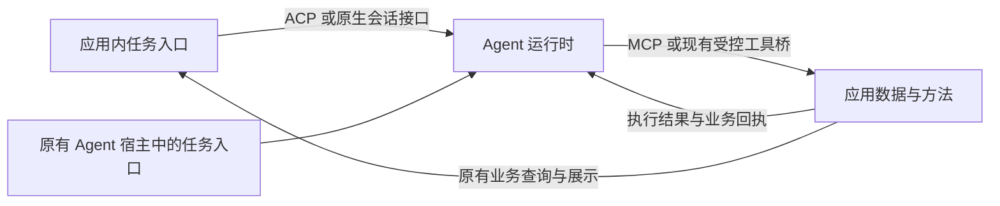

# 通用应用与 Agent 接入规范草案

中文原文 | [English](general-integration-contract.en.md)

两种语言属于同一规范、使用相同条款编号和版本；英文版是本原文的对应翻译。翻译差异以本原文核对并修正，不新增规则。

日期：2026-11-13。版本：normative draft 0.3。状态：语言与 SDK 无关的接入规范草案；未实现、未完成运行或独立互通验收。

本规范定义应用与用户自有 Agent 协作时的义务、能力配置和标准绑定。它复用 ACP、MCP 及明确记录的原生接口，不定义新的通用网络协议。应用可以使用参考 SDK，也可以独立实现；包名、函数签名、Node/TypeScript、青凝命令及存储路径均不是符合本规范的条件。

本文是接入规则的唯一规范性主文档；[SPEC](../SPEC.md)说明产品目标与交付，[SDK 技术设计](sdk-and-qingning-integration-design.md)只说明一种参考实现。两者的实现建议不得削弱本文义务。来源源码与历史差异已移至[实现设计的来源附录](sdk-and-qingning-integration-design.md#15-2026-11-02-历史来源基线)，不再混入规范要求。使用场景与操作基线仍见[产品定位](product-positioning.md)和[完整流程](v1-features-and-flows.md)。

“必须/MUST”“不得/MUST NOT”“应/SHOULD”“可以/MAY”按 [BCP 14](https://www.rfc-editor.org/rfc/rfc8174.html)表达义务；SHOULD 的偏离必须说明依据及等价保障，不得豁免 MUST。规范性引用按本文列明的版本及适用角色生效；上游标准的强制要求不能因参考 SDK 尚未支持而省略。示例、来源评估和未执行的验收场景不是已验证能力。

本修订补齐规则和验收定义，不冻结任一实际 Agent、宿主或连接产品已经兼容，也不授权开始开发。2026-11-02、2026-11-12 及 draft 0.2 的评审只覆盖各自旧版本；本轮三项运行规则的修订与独立评审见[本轮记录](reviews/2026-11-13-runtime-rules-review.md)，上一轮缺口补齐见[历史记录](reviews/2026-11-13-normative-gap-review.md)。

## 1 共同目标与两种入口

接入协议服务两种入口，共用应用的数据与方法定义、业务权限和执行结果规则：

| 入口 | 任务由谁发起 | 谁控制 Agent 对话 | 应用承担什么 |
| --- | --- | --- | --- |
| A 在应用中调用自己的 Agent | 用户在应用页面或对话区发起 | 应用通过 ACP 或原生适配管理本应用会话 | 提供任务与上下文、展示执行消息、提供获准方法、保存或展示结果 |
| B 在原有 Agent 中操作应用 | 用户在已有 Agent 宿主中发起 | 原有 Agent 宿主 | 通过 MCP 等受支持方式提供获准资源和方法，执行业务操作并返回结果 |

典型调用关系：



开发者与最终用户是链路中的角色，个人创建者可以兼任。新项目和已有项目仅接入时机不同，不产生不同协议。入口还可以由已有有效授权下的可信应用或服务发起，不要求真人每轮在线；主体、决定来源和后台等待按第 7.1 节处理，B 仍不因此交出原宿主的整个会话控制权。

通用目标包括纯对话、只读分析、内容生成和业务操作。没有业务写入的任务可以在完整产出交付后结束；有写入目标时，以应用确认的实际效果及必要读回为准。

## 2 规范与实现的职责边界

| 参与方 | 必须负责的事项 | 不因接入而取得的权限 |
| --- | --- | --- |
| 应用与原业务执行端 | 真实调用主体、对象权限、方法输入输出、事务、防重、效果核对及成果读回 | 不自动取得原宿主完整会话或其他应用材料 |
| A 的实际运行宿主 | 应用范围会话、受控进程/工具、任务与内容交付、所需交互，以及输出接收与材料披露控制 | 不因有效 MCP token 获得任意进程、目录或身份控制权 |
| B 的原有 Agent 宿主 | 原会话、原生执行权限、用户交互、跨服务披露；采用显式业务关联时还负责可信产生与重发接续 | 不因工具可见而绕过应用权限和写入准入 |
| 原生 Agent | 自身认证、推理/工具循环、真实会话历史和实际可用的原生限制 | 模型文字、工具描述和生成参数不能扩权 |
| 连接层 | 按第 12 节绑定真实双方、传递受保护控制与结果、执行撤权及重连规则 | 连接标识和显示名称不能代替认证 |

原应用继续是业务结果与防重的 canonical owner，原生引擎继续是历史 owner。公共库可以持有必要运行句柄和范围映射，不得借实现本规范建立竞争业务数据库、统一身份库、第二套 transcript 或无人消费的操作中心。绑定说明可以引用已有存储、认证、队列及连接机制，无需为每条规则新建服务。

实现必须覆盖自己声明的角色和所需能力，不要求 B 创建 SDK 会话，也不要求只读应用实现写入。项目最终的 A/B、本机/远端及已要求的写入目标仍分别保留，不得用较窄能力演示代替完整交付。

## 3 应用提供什么数据

以下是必须表达的语义，按入口与任务需要提供；不存在某类数据时可明确省略，不能为了填字段虚构内容。

| 数据类别 | 需要表达什么 | 谁提供或负责 |
| --- | --- | --- |
| 应用能力 | 可核验应用来源、可用资源与方法、支持的协议版本和可选能力、当前调用者可见范围 | 应用能力服务；连接身份由可信连接及认证机制确认，显示名称不是授权证明 |
| 用户任务 | 用户实际要求、必要约束和目标；结构化产出的 schema/所需保证见第 5.1 节，受信运行限制见第 7.2 节 | A 由应用传入；B 由原有宿主传给 Agent，应用不必复制整段用户对话 |
| 上下文内容 | 文本、支持的多媒体内容、应用对象快照或文件正文，带内容类型与来源说明 | 应用选择或经获准资源读取取得；只提供完成目标所需部分 |
| 资源引用 | URI 或应用可解析标识、类型、读取方式；会变化的材料需要版本或等价新鲜度依据 | 应用资源 owner；引用只定位对象，不自动授予读取权 |
| 完整性信息 | 当前是全文、摘要、截断片段还是分页结果；需要继续读取时给出受控入口 | 应用和读取方法；无法继续读取时明确限制，不能伪装为完整材料 |
| 工作与会话范围 | 本次允许的工作区、资源、方法以及会话对应的应用和认证范围 | 应用和可信接入层共同绑定；Agent 不能通过参数替换当前调用身份 |
| 方法调用结果 | 实际执行的数据、错误和业务效果回执 | 应用现有方法实现；见第 6 节 |

内容优先复用已有 ACP 内容块或 MCP 资源与工具内容。结构化对象使用应用声明的 schema；协议核心不定义论文、笔记、活动卡等领域对象。二进制、音频、图像和嵌入内容须确认接收方支持，不支持时明确拒绝或由用户接受有标记的降级。

资源内容是不可信业务输入，不能因文本中出现指令而提升权限。URI、路径、版本号、对象 ID 都不能替代访问校验。读取受保护资源应经过授权入口，不把长期密钥或可越权访问的链接作为普通上下文交给模型。

材料发生变化时，方法按版本约束重新检查；不能拿旧摘要悄悄覆盖新内容。纯文本常量不强制新增版本、摘要哈希或独立资源服务。

## 4 应用提供什么方法

方法是应用愿意开放的现有能力。协议交换的是描述和请求，不是把宿主内存中的函数或任意可执行代码直接交给模型。

| 方法定义内容 | 要求 |
| --- | --- |
| 名称与说明 | 在当前服务内可识别，说明做什么、何时使用、作用对象与结果含义；多个服务通过服务归属消除歧义 |
| 输入约束 | 使用明确的 JSON Schema 描述参数、必填项和允许范围；应用执行前真正校验，不能仅向模型展示 |
| 输出约束 | 需要机器消费或控制后续动作时提供可验证的输出结构；纯文本方法可以只声明文本结果。声明了 schema 就不能把任意输出包装成通过 |
| 业务效果说明 | 明确只读、修改、外部效果及是否可撤销；可复用标准注解，但注解不是授权证明 |
| 权限与前置条件 | 当前调用者可否操作目标对象、所需批准、版本条件，以及参数之外的可信作用域来源 |
| 重复与恢复语义 | 分别声明防止重复生效的依据和能否安全重试、返回原结果；写方法须通过下述重复执行准入。查询能力可以独立声明，不强制新增状态服务 |
| 版本与能力变化 | 方法定义变化后如何识别不兼容输入，当前可见目录如何刷新；目录缓存不使过期权限继续有效 |

优先复用 MCP tools 的名称、说明、输入输出 schema 和发现机制，不重建一份平行工具注册中心。现有 `cli(argv)` 可以作为迁移期工具适配方式，不要求立即把所有命令改成独立工具，也不能把青凝命令集规定为所有应用必须实现的方法。

### 4.1 写入准入与稳定业务关联

写入准入与自动重试是不同能力。所有产生持久修改或外部效果的方法，A、B 均必须由原业务 owner 原子防止同一业务请求重复生效，并为实际方法选择以下一种有证据的机制：

1. **原业务约束。** 复用已有幂等操作、稳定对象唯一性或不可复用的版本前置条件。必须验证其覆盖完整效果、并发与晚到重发，包括对象删除/重建、版本重置或引用重新分配后旧请求仍不能重新生效；仅“通常相同参数不会变”或只保护一张本地表不足以证明外部效果安全。
2. **可信业务请求标识。** 由真实应用入口或可信宿主在首次有副作用的尝试前，为一项明确接受的业务意图产生并保留稳定关联；在模型之外向实际调用注入。新 RPC ID、并发重发及声明支持的重启恢复必须沿用原关联。用户明确发起另一项新操作时才创建新关联；相同内容可表示两项合法意图，参数哈希不得普遍代替意图标识。

第二种机制的实际生产者是可信任务/操作入口，消费者是原业务方法执行端，必要状态存放于二者已有 owner。应用必须记录实际载体及其校验途径：可以复用应用 schema 的请求字段、可信传输 metadata 或已有请求上下文；本文不规定统一 `operationKey` 字段。字段、MCP `_meta` 或 HTTP header 本身不产生可信性；绑定必须写清模型不能覆盖的注入点和执行端验证依据。模型猜测的字符串、每次到达才重新生成的服务端键、仅由模型记住并回传的键都不构成可信关联。单独提供一个“领取新键”工具，也不能代替在首次效果前可靠保存并复用原关联。

不支持可信关联的普通 B 宿主，只能在原业务约束足以覆盖该方法时使用相应写入；否则必须在产生效果前拒绝该方法。批准窗口、目录注解、RPC/轮次/会话/IPC ID 都不能替代此准入。不能将已要求的创建或保存目标改成只读演示以获得通过。

### 4.2 实际写入绑定必须说明的内容

每个可写方法或一组语义相同的方法必须提供开发者可取得的绑定说明，应用方法 schema 可引用它，不强制新增网络发现接口：

| 绑定事项 | 必须明确的内容 |
| --- | --- |
| 机制与载体 | 使用哪项原生约束或业务标识；具体字段、metadata 位置或版本条件；缺少时的拒绝方式 |
| 产生与恢复 | 谁在何时接受业务意图、产生并保存关联；重发和支持的重启怎样恢复；怎样区分用户新请求 |
| 作用域与一致性 | 当前主体、方法、目标及业务参数如何绑定；同键不同输入必须拒绝，不能修改原意图 |
| 原子性 | 原 owner 如何在同一原子边界认领、防重和写入；外部效果依赖的下游幂等或等价接续保障 |
| 重复及并发 | 处理中重复如何返回等待、冲突或已有结果；不得并行执行第二次。重复可返回原结果或明确拒绝，不要求统一回执结构 |
| 保证范围 | 支持的重试/恢复范围、保留期限、过期识别与拒绝机制、效果核对入口；不得依赖无限保留或无依据固定期限 |
| 权限变化 | 每次重发、结果读取与查询仍校验当前权限；原关联不是 bearer 凭证，不得据此读取他人结果或恢复撤销权限 |

原业务 owner 必须在效果发生前校验上述条件。防重记录与业务提交不能存在可导致重复效果的间隙；下游效果不在同一事务时，必须由已有下游幂等或等价机制覆盖并可核对。本地事务回滚、记录成功或进程退出均不能单独证明外部效果未发生。

### 4.3 结果未知、期限与重新发起

响应丢失时，可信调用方只能沿原关联核对或按已验证机制重试，不能自动换键。关联遗失、过期或执行记录不足时，先停止原操作重试并核对原效果；无法核对则保留未知。过期识别必须是绑定中可执行的规则，例如已有带有效期的操作引用或原业务终态；仅删除去重记录后把旧请求当首次执行，不符合本规范。复用原 owner 的必要记录或范围凭据，不要求统一墓碑库。

只有真实用户或可信业务流程明确接受另一项新意图，才可以按当前权限建立新关联；系统不得用“请再点一次”或自动重新领键掩盖未核实的原效果。若方法只声明拒绝重复、不支持回放原结果，必须明确说明核对方式，不得把防重能力显示成安全重试或完整恢复。

以上是本项目为未知效果安全提出的约束。行业 API 各有保留与重放语义，不能直接采用“过期后同键作为新请求”的行为而声称满足本规范。[AWS 幂等实践](https://aws.amazon.com/builders-library/making-retries-safe-with-idempotent-APIs/)、[Google AIP-155](https://google.aip.dev/155)和[Stripe 请求幂等](https://docs.stripe.com/api/idempotent_requests)是机制参考，不是新的共同传输标准。

MCP 服务的来源、启动配置与运行环境应由可信安装或用户设置确定，不能由模型生成的方法参数改写。方法描述也不能授权任意程序启动或凭证读取。

应用只开放实现目标所需的方法，不强制具备写入、文件系统或终端工具。若存在这些高权限路径，它们与业务工具必须共同遵守真实授权范围，不能绕过其他方法的拒绝。

## 5 Agent 返回什么

| 返回类别 | 含义 | 消费规则 |
| --- | --- | --- |
| 用户可见内容 | 回复文本、支持的多媒体、建议或报告 | A 由应用展示，B 由原有宿主展示；按不可信内容处理，不自动执行其中代码或链接 |
| 应用要求的结构化产出 | 实际内容及声明的生成约束/校验状态；满足 schema 后才作为相应候选消费 | 按第 5.1 节核验，不把原生完成、未检查或无效内容显示成校验通过；仍不等于业务正确或已经保存 |
| 方法调用请求 | 方法名、参数和相关调用标识 | 交给对应方法实现做当前授权、输入与业务前置条件校验，再决定是否执行 |
| 执行与工具事件 | 进展、工具开始或结束、等待用户、当前轮次结束或失败等 | 在适配能力范围内展示；日志片段不能冒充完整最终产出，工具状态也不能代替应用提交回执 |
| 需要用户参与的请求 | 具体问题或需要批准的操作及目标范围 | 由当前控制该交互的应用或宿主呈现；没有批准通道时，不得把需要批准的操作默认放行 |
| 产物引用 | 生成内容的引用、类型与必要元信息 | 接收方取得实际访问权限后读取；文件路径本身不证明可访问或已被应用接收 |
| 引擎结束信息 | 完成、失败、取消，以及引擎实际报告的模型和用量 | 进程或轮次结束仅说明执行状态；未返回的用量显示未知，不能推导成零 |

协议不要求暴露模型内部推理。Agent 生成的方法代码或新工具建议属于产出，不能自动安装成新方法，也不能自动获得更高权限。

A 中，参考实现需要把用户可见内容和必要事件完整交付应用；当前公共引擎接口的 `onLog`、`exitCode` 不足以证明该出口已统一。B 中，应用通常只收到 MCP 方法调用，不应要求取得原有宿主的完整会话、全部流式输出或其他工具的活动。

### 5.1 结构化产出的保证与校验

应用必须能在任务或其实际绑定中表达所需产出 schema、方言/版本及必要子集，并说明是否要求原生生成约束，或接受完整内容交付后由受信宿主解析校验。具体承载位置沿用选定标准/原生配置及公开绑定，不规定统一函数、供应商参数或 ServerAgent 候选结构。MCP 工具的 `outputSchema` 约束真实工具结果，不自动提供模型生成约束。

| 保证方式 | 必须准确声明的含义 |
| --- | --- |
| 原生生成约束 | 选定引擎/模型版本确实以其支持的结构约束机制接收相应 schema；说明支持子集及限制。仅提示“输出 JSON”、普通 JSON 模式或事后修补，均不能冒充对该 schema 的原生约束 |
| 宿主解析与校验 | 受信宿主或其选用的 SDK 校验器按声明规则解析实际完整内容，并对约定 schema 进行验证；可以作为应用接受的产出方式，但不能声明原生约束已生效 |
| 未提供相应保证 | 原始输出仍可按获准用途交付，但未执行的校验、未知的原生配置或仅能解析的片段，不得被标记为满足所需结构化目标 |

绑定必须区分“调用方要求的方式、实际启用方式、内容完整性、schema 校验是否执行及其结果、原生轮次终态”。这些是可观察语义，不要求新建统一结果报文；实际字段、原生映射和校验负责方须在实现绑定中明确。要求原生约束但实际组合或 schema 子集不支持时，必须在相应原生执行前拒绝；只有可信调用方明确接受另一种满足其目标的方式，才可以采用，不能静默降级。

原生约束不表示所有运行都必然返回合格数据。拒绝、截断、取消、无产出、解析失败及 schema 不符必须分别保留真实原因；可解析 JSON 不等于 schema 通过，原生轮次完成也不等于约束满足。完整性按声明的目标内容/产物边界判定，不能用局部可解析片段证明所需整体完整。

schema 校验必须按声明方言和实际支持的断言生效，不能默默忽略不支持的关键字；`format` 等只作注解还是确实断言须说明。语法/schema 合格不证明事实、单位、对象存在、当前权限、业务正确性或已提交。业务验收与成果保存/启用仍由原应用负责，不因 SDK 提供通用校验器而移交业务权威。

解析、提取或规范化若改变实际内容，必须按绑定说明披露转换及原内容的可核对关系；不得补默认值、删去不合格字段后冒充原生产出满足要求。核对仍受原授权与诊断隐私约束，不强制持久保存全部私密原文。自动补生成、修复或重试须由可信调用方策略授权并计入原有时限/预算，不因格式失败换新任务、重置额度或重跑未知业务效果。

## 6 应用方法返回什么

工具结果由真实执行方产生，不能与模型生成的结构化输出混同。MCP 标准已有 `content`、`structuredContent`、`isError` 及可选 `outputSchema`；应复用对应版本的字段，具体要求见 [MCP 工具规范](https://modelcontextprotocol.io/specification/2026-07-28/server/tools)。

应用结果至少能回答：本次请求是否被接受并执行、取得什么数据、是否产生业务影响、失败或不确定时如何处理。需要业务回执的方法，应按自己的输出 schema 返回这些事实：

- 与当前调用及授权对象关联的操作标识。
- 已确认效果及其结果对象、版本或其他必要引用。
- 应用已提交、明确未执行，或结果仍需核对的真实状态。
- 可以读回或查询的入口；没有可查询能力时明确说明，不能生成一个假的状态服务。

这些是方法结果的语义，不要求另造一套覆盖所有工具的固定业务回执结构。只读方法无需伪造提交状态。应用声明的业务效果，以可信方法返回和必要读回为准，不能由 Agent 的“已经保存”文字证明。

MCP 2026-07-28 的结果还必须按实际类型区分最终结果与 `input_required` 中间结果。后者携带的 `inputRequests`、不透明 `requestState` 及接续请求的 `inputResponses` 不得被文本化或丢弃；具体接续见第 8 节。它既不证明业务完成，也不单独证明尚未产生效果。存在中间效果的方法必须说明原 owner 如何防重和核对。

工具结果不得由 SDK 猜测成通用“已提交”标志。实现迁移自己的旧结果格式时必须明确 codec 与保真规则；青凝原格式的兼容设计见 SDK 文档，不作为其他应用的结果结构。

## 7 会话 作用域与控制约定

| 边界 | 共同规则 |
| --- | --- |
| 身份与授权 | 可信连接绑定应用、当前调用者和批准范围；执行前检查当前业务权限与撤销状态。方法参数、工具目录、应用名称和协议能力声明都不能授予权限 |
| 输出接收与读取 | 输出订阅、查询、重连、结果/历史/产物访问与实际交付均匹配当前应用、主体及有效授权；持续连接有撤权失效机制。账号/工作范围切换、注销或撤权时隔离旧展示和缓存，拒绝旧上下文迟到更新，不能把甲的输出交给乙；原 owner 保留的历史也须在后续读取时校验授权 |
| 原生执行路径 | A 的接入层落实其管理的文件、终端、网络及工具限制；B 的这些权限归原宿主与用户管理，应用服务只能保证自身授权边界。MCP 授权不是整个 Agent 的沙箱；若目标要求更强隔离，需由实际宿主提供并验证，否则明确不支持该承诺 |
| 会话归属 | A 管理应用范围内的引擎会话映射，原生历史仍归引擎；B 的 Agent 对话归原宿主，应用仅保存自身业务与调用所需记录 |
| 会话恢复 | 先检查原生支持和绑定范围；恢复失败说明实际状态。当前实现存在新建会话回退，但通用化不能将其显示为原会话完整恢复 |
| 标识 | 复用 RPC 请求 ID、原生会话 ID、工具调用 ID 等关联信息；它们分别标识不同层级，不默认充当业务幂等键或授权凭证 |
| 幂等与重放 | 写方法通过第 4 节准入，原 owner 按已验证的业务约束或稳定业务关联原子防止重复生效，重复可返回已有结果或被拒绝。A、B 重发都遵守，不能仅约束己方自动重试；能否安全重试或查询另行声明 |
| 跨服务披露 | B 原宿主负责跨服务上下文聚合与披露控制。范围包括工具参数、返回应用的文本/事件、结构化产出、产物及历史读取；连接多个服务或由应用发起任务不等于许可向该应用输出整段会话。披露须符合用户已批准的数据范围、目的与接收方，工具描述、资源或结果不能扩大许可。应用服务权限不能证明此项隔离；宿主不能落实混合来源输出控制时，该共享敏感组合不得声明通过隐私验收，应使用范围相符的运行组合或拒绝。A 汇集多个服务时同样由其实际宿主承担 |
| 并发与版本 | 同一原生会话按支持条件串行或排队；业务写入仍执行应用自己的事务与版本检查，不能用模型任务串行替代数据库并发控制 |
| 停止与取消 | A 在能力范围内请求停止受控会话；B 只能按已协商能力取消本应用的具体调用，不能宣称停止整个外部 Agent。收到取消不证明已写入内容回滚 |
| 未知结果 | 超时、断线或进程退出后，先向原应用核对实际效果；未核实前保留未知结果，不推定未写入或盲目重试 |
| 错误与变化 | 区分传输失败、协议不兼容、认证、权限、参数、版本冲突、执行失败和效果未知；沿用对应标准错误，再补充必要应用说明 |

青凝的 TaskCommandScope 只能在其可信服务进程中校验。可复用的是“真实调用前重新检查有效作用域”的规则，不是把这个 handle 序列化后当成通用网络授权。对外授权仍复用已有标准机制与应用身份体系。

跨服务使用可以事先按目的、数据范围和接收方获得明确授权，例如用户要求把资料库选定内容整理后存入指定笔记服务；同一范围内无需重复询问。但仅授权读取资料库、仅授权修改图片标签，不能推导为允许把资料库正文作为标签参数或回答内容发送给图片服务。接收身份正确与材料获准披露是两个独立条件，实际宿主同时落实，不能依赖目标服务自行识别材料来源。不要求新建来源数据库或每字符查询权限，能力不足时也不能以这些实现成本为由声称已经满足目标。

### 7.1 后台受托发起与交互决定

后台发起必须区分真实认证调用主体、已有授权/委托的来源、当前操作决定方和实际输出接收者。来源由原应用或原宿主的既有身份/授权机制验证；模型、业务材料、调用参数或一个自称委托的对象不能授予权限。委托的业务含义、颁发、持久记录及维护触发仍归原 owner，Bridge 不新建委托中心、维护队列或活动版本状态。

| 决定来源 | 必须保持的语义 |
| --- | --- |
| 当次真人决定 | 来自有权主体对当前请求的真实选择或补充，不以旧回复或策略决定冒充当次点击 |
| 当前有效策略决定 | 由模型之外的可信宿主，依据已有有效用户设置或委托，在实际绑定允许的范围内自动允许/拒绝；必须能核对策略依据与适用范围，不伪称当次真人决定 |
| 尚缺有效决定 | 无覆盖策略、必须当次人审或缺少必要信息时，明确等待、拒绝或按已声明策略超时；不得把缺少界面、无人在线或引擎默认选项解释为批准 |

策略决定必须覆盖当前主体、动作、实际目标/相关参数、有效期及撤权状态；原业务执行权限与输出接收/材料许可仍分别检查。恢复、等待后继续、答复交互和实际执行时都须验证当前适用条件。批准不能扩权，操作或解析后目标改变不能沿用不相符的旧决定；有效策略可重新判断，一次交互的回复仍须绑定当前请求并一次消费。长期有效策略及原生记忆决定可以按原 owner 的规则复用，不因上述一次消费要求被另建成第二份权限存储。

自动许可仅在选定标准与运行组合允许时生效。[ACP v1 许可](https://agentclientprotocol.com/protocol/v1/tool-calls#requesting-permission)允许客户端按用户设置自动处理；`allow_always/reject_always` 的原生记忆、范围与期限仍由 Agent 管理。选项名称、标题或 `selected` 本身不证明真实授权/真人参与，不能为后台运行切换到更宽权限或减少已要求的人审。

许可决定与补充信息不能混为一类。只有标准及实际绑定允许时，才能从可信且获准来源自动提供已有事实；不得编造未知信息或冒充真人填写。[ACP v1 form elicitation](https://agentclientprotocol.com/protocol/v1/elicitation#user-interaction-requirements)要求用户审阅/修改后提交等上游强制交互必须保留，有效委托不豁免该要求。当前请求必须当次人审而没有相应路径时，按需求等待或拒绝该组合，不能自动答复。

等待策略必须对调用方可知，区分有界等待和已有机制支持的持续/持久等待；有界任务不得因等待而突破第 7.2 节限制。通用交互不强制统一超时，持续等待也不被展示为正在推进或业务已完成，且仍响应取消、撤权和原请求失效。声称跨重启保留待决请求时，必须有现有 owner、范围与恢复证据，不据 ACP 连接或本地 Promise 自动推定持久等待。

决定来源与最小核对关联通过原生映射、可信运行上下文或现有审计表达，并遵守第 13 节最小化规则；不是新增 ACP 根字段或统一委托 schema。每项绑定须列明自动处理范围、当次人审条件、补充信息来源、等待/失效/取消行为和决定依据负责方。业务委托策略及谁在何时维护由消费者决定，不强制用户每轮在线，也不保证任意引擎均支持无人值守。

### 7.2 主任务、时限与预算的承诺边界

限制来自当前可信宿主策略及有效授权，适用于主任务和其实际受控的辅助/派生操作。实现必须在产生相应执行效果前核对任务要求与实际能力，按声明的保证程度落实检查或观测；对承担准入/停止的限制，在开始前、资源等待后及继续执行前核查。模型文字、工具结果或生成参数不能扩大、延长或重置限制。

| 限制说明 | 必须明确的内容 |
| --- | --- |
| 对象与计量 | 整体宿主任务、原生轮次、某次模型/工具调用或辅助操作；量值、单位与统计范围。token 维度、费用币种/价格依据和估算属性不得含糊混用 |
| 时间边界 | 绝对截止时间、相对等待时长或累计活动执行时长分别表达；说明起点，以及排队、资源等待、人工批准和补充信息等待是否计入。墙钟截止时间不能因等待交互暗中暂停 |
| 实际约束方 | 由哪个原生执行端、可信宿主或计费/资源边界落实，实际控制哪些进程、调用与在途工作；具体字段/参数及证据放在绑定中 |
| 超限与恢复 | 到限后的准入、停止、结果与未知状态；跨端传播、重连/重启时限/剩余额度如何接续，以及所需现有状态 owner |

每一维度必须分别声明保证程度，不用一个“支持预算”笼统代替：

- **硬限制：**实际可信控制边界能强制约束明确声明的对象、指标和范围。限制新工作准入、限制客户端等待、终止本地进程、停止远端推理和限制最终账单是不同承诺，不能相互替代；任何允许误差、执行延迟或在途排除范围必须说明，不得将实际允许越界表述成零越界保证。
- **协作停止：**到限后停止接纳新的受控工作，并向实际执行方发出取消/停止请求；在途及远端工作是否停止依真实确认报告，不能声明已经硬停止。
- **观测/告警：**报告已观察时间、用量或估算费用；不声称能够阻止超限。缺少、迟到、部分或估算数据不当作零或最终账单。

任务必需的硬限制若无法由所选组合落实，必须在首次相应原生执行前拒绝；可选保证采用较弱方式须由可信调用方明确接受，安全义务不得被豁免。未设置某项上限不表示无限重试或无限授权；数值、默认策略、整体维护次数、排队和业务重试由原宿主决定，不在规范统一规定分钟数、token 数、供应商参数或新增 Bridge 账本。

跨机器或下游传播必须保留原约束并扣除已耗时间/额度，使用经校验的时钟依据或剩余时长，不把另一机器的单调时钟当本机时间，也不能在每一跳重新取得完整原始 timeout。重连、重启、恢复或同一任务重试不自动重置原期限、累计用量及剩余额度；无法可靠恢复任务所需约束时，拒绝继续或取得明确新授权，不假设重新满额。限制的授权变更须显式记录，不改写先前实际超限事实，也不免除第 4 节未知效果核对。

到期/耗尽后按声明的范围和保证处理：硬限制/协作停止不得再发起其负责范围内的新受控执行，过期的待决批准不能使其重新开始；仅观测的组合报告真实观测与限制，不冒充已阻断。按真实能力请求停止并保留结果核对路径。请求接受、停止信号发出、本地退出、原生终止、远端工作停止及业务回滚分别报告；超时、关闭连接或本地 kill 不证明远端计算/计费已停止或外部效果未发生。[ACP 取消](https://agentclientprotocol.com/protocol/v1/prompt-turn#cancellation)按实际原生确认映射，不将 UI 预标状态当终止证据。控制/观测失败或效果未知仍沿原 owner 核对，不因 deadline、usage 丢失或格式失败自动重跑。

用量与费用必须说明来源、范围和完整性。输出 token 限制、模型请求次数或成本观测不能自动证明精确账单上限；费用硬保证只有在实际计费/执行边界能覆盖声明费用范围时才可声称，并说明在途请求、报告延迟和其他费用的边界。子进程、计时器、AbortSignal、原生 flags 与跨端绑定均为实现选择；不因此替消费者决定维护策略、候选启用或新建调度/状态中心。

## 8 哪些复用标准 哪些需要补充

本修订的标准绑定基线是 ACP v1 和 MCP 2026-07-28，下面按各自语义规范性引用；这不等于任何实际引擎组合已经通过。声明旧版 MCP 或其他原生接口的实现必须另列精确版本、能力和等价映射，不得把旧握手、旧交互方式标为本基线。ACP v2 草案与 MCP 可选扩展不自动成为依赖。

| 标准绑定 | 必须保持的行为 |
| --- | --- |
| ACP v1 会话 | 按 [initialization](https://agentclientprotocol.com/protocol/v1/initialization) 协商版本与能力，再建立会话；按原生支持传入 MCP 配置。要求恢复时，失败必须显式返回，不能将 `session/new` 显示成恢复成功 |
| ACP v1 轮次与交互 | 保留用户可见内容、真实停止原因与所需交互；工具状态通知仅观察，不再次执行。批准与补充信息分别协商；未支持必需交互不能默认同意 |
| MCP 2026-07-28 版本 | 按 [versioning](https://modelcontextprotocol.io/specification/2026-07-28/basic/versioning) 与 [metadata 定义](https://modelcontextprotocol.io/specification/2026-07-28/basic/index#meta)，每请求 MUST 携带 `io.modelcontextprotocol/protocolVersion` 和 `io.modelcontextprotocol/clientCapabilities`；`io.modelcontextprotocol/clientInfo` 为 SHOULD，可按明确配置省略，其缺失不得被当作认证失败或必需能力不足。不套用旧 `initialize` 握手；客户端信息不作为身份凭证 |
| MCP 2026-07-28 工具 | 复用发现、输入输出 schema 和标准结果；保留 `resultType`、`content`、`structuredContent`、`isError` 及声明能力所需字段，不能仅保留显示文本 |
| MCP 2026-07-28 多轮接续 | 根据 [tools](https://modelcontextprotocol.io/specification/2026-07-28/server/tools) 与 [MRTR](https://modelcontextprotocol.io/specification/2026-07-28/basic/patterns/mrtr) 处理 `input_required`；实际客户端在有权处理交互的一端取得决定，保持原业务参数并原样回传 `requestState` 和匹配的 `inputResponses`，使用新的 JSON-RPC ID。这是原逻辑操作的接续，不是新业务意图 |
| MCP 网络授权与传输 | 受保护 HTTP 服务遵循选定版本的 [authorization](https://modelcontextprotocol.io/specification/2026-07-28/basic/authorization) 和传输安全要求；stdio 采用可信父进程、操作系统权限和受控运行配置，不能把 HTTP OAuth 机械套到进程内接口 |

`requestState` 是协议接续状态，不自动提供身份、防重或单次批准保障。影响权限或业务的状态必须保护完整性、绑定当前主体、原请求与有效期；需要一次消费时由原 owner 原子落实。客户端必须把它作为不透明状态原样保留，不能由模型重建、修改或因断线生成一个替代状态。其失效、拒绝和效果未知仍按第 4、7 节处理。上游取消、不支持交互和认证失败必须映射到实际状态，不能隐藏为成功。

| 能力 | 优先复用 | 本项目需要落实或补充的内容 |
| --- | --- | --- |
| 版本与消息传输 | 上表所列 ACP/MCP 版本机制 | 固定实际绑定与能力证据，不复制通用 RPC，不用任意回显版本表示兼容 |
| 创建与恢复会话、发起轮次 | ACP 会话接口；不支持的引擎沿现有原生适配 | A 的应用范围映射与真实回退行为；B 不要求应用管理外部 Agent 会话 |
| 文本与支持的内容块 | ACP content；MCP 工具内容或资源 | 按能力映射内容与资源引用，保留来源、版本及摘要或截断语义，不能静默丢失必要内容 |
| 应用方法的发现与调用 | MCP tools | 保留原应用方法 owner，映射现有命令及目录，落实输入输出校验和当前权限 |
| 应用资源与模板 | MCP resources、prompts，在有真实需要且宿主支持时使用 | 当前桥只有工具出口；资源可先通过获准读取工具提供，不为形式齐全强制新增资源或模板服务 |
| 工具进展与用户可见输出 | ACP updates；MCP 工具结果及支持的进度能力 | 为 A 归一实际可获得的输出与事件；B 不承诺向应用镜像整个 Agent 过程 |
| 权限请求与人工补充 | ACP 权限交互；MCP elicitation 或对应版本的受支持交互 | 确定由谁显示和执行批准，并绑定到具体操作；应用业务校验不可被提示框替代 |
| 工具结构化结果 | MCP structuredContent 与 outputSchema | 保留并校验原应用实际返回，修补当前文本桥的字段保留缺口；不能把输出声明当作已验证结果 |
| 长操作与取消 | 对应标准的取消、进度；MCP Tasks 等可选扩展按需协商 | 解释在途业务效果、查询与恢复，不新增第二个业务执行状态 owner；不要求所有客户端支持可选扩展 |
| 业务回执、幂等与撤权 | 原应用当前机制；标准认证、授权及调用通道 | 按写入准入防止 A、B 重复生效；缺少保障先拒绝相应写能力，安全重试和结果查询分别声明，未知结果先核对 |
| 跨服务上下文披露 | 原宿主已有上下文隔离、披露控制与用户同意机制 | 明确材料可以发往何处、用于何事；能力不足时不宣称提供该隔离，不让单个应用 MCP 授权代为证明 |
| 个性化配置 | 原生 Agent 支持的配置方式 | 用户选择加载、来源说明、权限兼容及实际生效情况；不统一导入全部个人目录 |

ACP 已定义会话及交互内容，MCP 已定义工具、资源及相应结果结构；本项目主要补充的是它们与应用、原生引擎之间的一致接入规则和参考适配。ACP 也明确允许传入 MCP 服务配置，见 [ACP 架构](https://agentclientprotocol.com/get-started/architecture)。

应用若把整个 Agent 封装成 MCP 工具，是另一种可选封装，需定义其会话和结果语义；不等同于入口 B，也不是本轮要求新增的第三条必选执行路径。

## 9 两种入口怎样完成一次调用

### A 应用发起

1. 应用确认调用者、所需能力及第 11 节绑定；按实际标准完成版本/能力和权限检查。需要显式写入关联时，由可信入口在首次效果前建立并保存。
2. 在获准范围内创建或恢复会话，传入任务与必要内容；采用 ACP 时可提供获准 MCP 服务配置。
3. Agent 处理输入，返回用户可见消息或方法调用请求。实际方法调用由对应 MCP 或受控工具通道承载，ACP 工具状态通知本身不是再次执行业务的指令。
4. 应用方法校验当前身份、输入、批准范围、重复执行准入和业务前置条件后执行，返回真实结果；跨服务材料由实际宿主确认披露范围。
5. Agent 根据结果继续处理，应用展示内容和实际状态。
6. 纯分析目标在完整交付后结束；业务操作目标在取得应用回执及必要读回后结束。若状态未知，进入核对流程。

### B 原有 Agent 发起

1. 应用提供受保护的 MCP 能力服务及连接说明，用户在自己的 Agent 宿主中连接并授权。
2. Agent 发现当前可见的方法或资源；当前页面选择若有必要，也必须通过明确的获准数据入口取得，不能假定 Agent 自动知道应用 UI 状态。
3. 用户在原宿主发起任务，宿主按已授权目的、数据范围和目标服务控制参数中的材料披露，Agent 调用应用提供的方法；工具或资源内容不扩大该许可。
4. 应用按同样的输入、权限、版本和第 4 节写入绑定执行；外部宿主在模型之外传递并沿用原业务关联，或由原业务约束覆盖。不满足则拒绝对应写入。需要人工决定时走已支持的交互路径；MCP 多轮接续按第 8 节保留原逻辑操作，不能自动扩大权限。
5. 原宿主继续对话，应用按自身业务查询或事件更新成果展示。应用不必收到原宿主最终自然语言回答才能确认自身已完成的业务效果。
6. 断线、停止和重试按调用效果处理。应用可撤销自身服务访问，但不据此删除或接管原宿主对话。

## 10 通用性示例

| 应用 | 应用自己声明的方法与对象 | 保持相同的约定 |
| --- | --- | --- |
| 资料库 | 读取材料、创建笔记及其应用 schema | 获准资源、方法描述、调用校验、产出与已保存效果分开表达 |
| 图片管理器 | 查询图片、更新标签及其应用 schema | 同样的输入输出、版本冲突、授权、结果与恢复规则 |
| 只读问答工具 | 提供选定文本，可没有写方法，也可没有工具 | 完整内容交付即可完成，不强制生成业务写入或伪造回执 |

例如某图片应用的方法可声明以下语义；这是应用方法示例，不是协议固定方法名或冻结的网络消息：

```text
方法：set_item_label
输入：itemId、expectedVersion、label；防重依据采用已验证版本约束，或要求可信上下文中的稳定 operationKey
成功结果：operationId、实际结果对象及其新版本；已提交状态由应用确认
失败：对象无权访问、版本冲突、输入无效或执行失败
恢复：支持时按 operationId 或同一业务键查询；否则保持未知并由用户核对
```

应用方法的 schema 还需限制自己的标签、对象和操作规则。请求 ID 负责响应匹配，operationKey 只有在应用实现相应原子防重、必要关联保留和明确结果处理时才有业务防重意义；它不自动授予安全重试、回放原结果或无限期去重能力。

同一应用可以同时提供 A 和 B，两种入口调用相同的原业务 owner。仅声明两个入口相同的 JSON 结构，不足以证明权限、效果和重试语义一致。

## 11 最低符合性与能力声明

符合性针对明确的实现、角色、版本与运行组合，不针对品牌。身份、失权输出和材料许可始终是通用基线，未声明多服务能力不表示允许任意披露。一个实现必须满足所有通用要求、至少一个声明角色及该任务必需的条件要求；只实现 B 不要求实现 A，缺少必需保障不得通过用户同意降级。暂不支持的入口或部署组合必须单独标注，不得由基础符合推导全部产品目标完成。

| 要求范围 | 最低义务 |
| --- | --- |
| 通用基线 | 遵守第 2–7、12–13 节适用的身份、数据、授权、效果、隐私与失败规则；正确拒绝不支持能力；不伪造字段、输出或已提交状态 |
| A 运行角色 | 任务/获准材料进入受范围约束的会话，完整交付任务要求的用户内容，报告实际终态，支持可验证的停止或明确不支持；处理所需批准/补充。恢复不是默认必需能力，持续使用与恢复声明分开 |
| B 应用工具角色 | 通过受保护的标准 MCP 或已记录原生绑定发现并调用真实应用能力；保留当前授权、结果与原应用读回；不索取整个外部会话 |
| 条件：写入或外部效果 | 第 4 节完整写入绑定、原子防重、响应丢失核对；不具备保障的方法不得执行 |
| 条件：人工交互 | 声明批准与补充信息各自的支持，保留上游必须的人审；按第 7.1 节区分真人、有效策略及未决来源；具体回复绑定请求并一次消费，过期/取消/撤权后拒绝 |
| 条件：受托后台运行 | 按第 7.1 节校验当前授权和策略，区分决定来源与输出接收者，明确等待/失效/取消及恢复边界，不默认批准或扩权 |
| 条件：结构化产出 | 按第 5.1 节声明所需与实际保证、schema 方言/子集、校验负责方与结果，不能把原生完成或文本可解析当作约束满足 |
| 条件：运行时限/预算 | 主任务与辅助操作按第 7.2 节分别声明计量、计时、保证范围与约束 owner；必需硬保证缺失先拒绝，恢复不自动补充额度 |
| 条件：恢复/重放 | 区分继续存活会话、恢复原生历史、结果查询及事件重放；说明实际持久 owner、期限与缺失状态，不能静默新建或重发 |
| 条件：跨进程/网络 | 满足第 12 节实际传输、机器/服务授权、来源与重连要求；stdio 不自动证明远端安全 |
| 条件：多服务或历史材料 | 按第 7 节落实接收身份与材料许可两条边界；不能控制混合来源输出的敏感组合不得声明通过 |

每个可用组合必须有一份可取得的实现绑定说明，写在已有兼容说明或应用接入文档即可，不要求新注册中心或网络 endpoint。最少记录：本文版本、A/B 角色、实现/适配器/引擎及标准版本、实际传输与认证方式、能力及不支持项、内容/事件/终态与错误映射、交互决定来源/等待策略、结构化约束及校验映射、时限/预算范围/保证与恢复依据、写入绑定、恢复范围、连接与诊断 owner，以及对应验收证据。

原生绑定必须逐项把上述语义映射到已有字段/操作；沿用标准字段时引用固定版本，只有真实缺失语义才补最小适配。映射缺项时只能标为未支持，不能把函数存在或进程可启动当作符合。新增可选字段不得改变旧语义；不兼容变更必须更新本文/绑定版本并给出消费者兼容与回退说明，不自动接入未来上游草案。

能力“文档声明、源码确认、真实流程通过、独立互通通过”分别报告。要求在发布某一兼容组合前固定上述绑定，并不要求在没有消费者时先创建通用状态服务。规范修订本身与实现能力冻结、软件发布分别验收。

## 12 连接与部署安全

MCP 应用资源授权、A 的 Agent 运行控制授权是两条独立边界。有效应用 MCP token 不授予启动任意进程、选择任意 env/profile、读取凭证目录或控制整台机器的权限。进程内/stdio 可以复用可信父进程与 OS 权限；网络运行服务必须通过实际连接层建立受认证控制关系。

每个网络连接绑定必须明确真实应用/客户端、用户、运行服务或机器的认证方式，操作与材料范围、凭证受众、授权唯一 owner、过期/撤权/轮换以及断线和服务重启后的再认证行为。机器 ID、会话 ID、显示名称或配对码不作为长期授权；控制通道与 Agent 可达的应用方法回调分别验证。远端 `localhost` 不等于用户电脑。

- 受保护 HTTP MCP 按第 8 节引用的授权规范实施资源发现、token 校验及受众限制，正确区分 HTTP 401/403 和工具业务失败。不得接受为其他资源签发的 token，也不得把收到的 MCP bearer 作为独立下游 API 的凭证转发，即使它已通过入站验证。调用其他资源时复用现有授权机制，使用为该下游资源单独签发、与实际主体及范围一致的凭证，见[访问令牌权限限制](https://modelcontextprotocol.io/specification/2026-07-28/basic/authorization/security-considerations#access-token-privilege-restriction)。可信进程内传递已认证身份上下文不等同转发 bearer，仍须执行原业务权限检查。原生应用采用 OAuth 时按 [RFC 8252](https://www.rfc-editor.org/rfc/rfc8252.html)及[RFC 9700](https://www.rfc-editor.org/rfc/rfc9700.html)使用适用的外部浏览器、PKCE 和重定向保护；不让用户向业务表单复制原生登录令牌。
- 本机 HTTP 不能因 localhost 而免认证。[Streamable HTTP](https://modelcontextprotocol.io/specification/2026-07-28/basic/transports/streamable-http) 按标准校验 Origin 并拒绝非法来源；本机监听应限制于必要 loopback/受控接口。Origin、CORS、Host 检查不能代替主体认证，缺少 Origin 的客户端也不自动可信。自定义本机 HTTP 控制通道必须声明等价来源/Host 与认证防护。
- 远端通信使用受保护传输；loopback OAuth 回调允许的 HTTP 例外不扩展到普通远端服务。地址发现、OAuth 元数据、重定向和回调采用实际部署的 URL/出站策略，每一跳及实际连接均防止越过允许网络范围、DNS 重绑定或私网/链路本地地址滥用。合法内网/loopback 用途单独声明，不靠一律禁止本机地址通过检查，模型不能修改该策略。
- 采用配对码时，可信两端必须核对实际应用、主体、目标机器/服务与范围；挑战有明确有效期、单次兑换、防猜测与并发重放保护。错误主体、过期和重复兑换必须拒绝。寿命及重试参数由所选连接实现说明依据，不在通用规范设任意分钟数，不将码作为永久 bearer。[设备授权流程](https://www.rfc-editor.org/rfc/rfc8628.html)只在适用场景选用，不要求全部桌面接入另造配对系统。
- 撤权后拒绝新的控制/工具调用，已有输出连接和重连不得继续向失权主体交付；在途及已提交效果由原业务 owner 核对。撤权不承诺停止整个外部 Agent、回滚成果或远程收回已合法交付内容。

实际连接实现可以直接引用已有标准与经过验证的连接层，但必须列出职责映射和通过证据。自定义 framing、取消、重连、寿命与错误必须在绑定说明明确，不将 WebSocket 或远端 URL 本身当通用 ACP 支持。仅安装 SDK、运行库或连接成功不足以完成 Web→本机/远端的验收。安全依据见[MCP 安全最佳实践](https://modelcontextprotocol.io/docs/2026-07-28/tutorials/security/security_best_practices)。

## 13 诊断、临时数据与隐私

诊断记录不是业务结果 owner。实现必须复用实际应用/运行宿主的诊断政策，明确收集目的、最小数据、接收方、访问控制、保留与清理责任；没有必要的数据不得以“调试”名义默认长期收集。

- 认证头、登录令牌、私钥、完整授权码等秘密不得进入普通日志、错误文本、事件或遥测。私密上下文、完整工具参数/结果和产物原文默认不作持久诊断；确有必要的受控留存必须按既有告知/授权和策略说明目的、范围、访问及期限，不隐式开启第三方原文上报。
- 必要审计可记录最少关联、时间、动作、目标类别和真实结果，读取仍受当前权限约束；处理日志注入及敏感错误拼接。审计与原业务防重/恢复记录不因账号切换、退出或诊断清理被无条件删除，也不设统一无限期或无依据保留天数。
- 内存缓冲、IPC 临时文件与缓存按主体/工作范围隔离，受限访问并有明确大小边界。完成、取消、过期、崩溃后启动及账号切换分别说明清理或后续不可读机制；清理失败不得变成跨主体可读，也不得抹掉原 owner 必需的核对记录。
- 诊断故障不改变已提交事实，不触发业务重跑。若既有策略要求先具备审计才允许执行，写入前失败应拒绝；提交后记录失败仍保留真实业务状态和必要恢复路径。
- 原生历史、业务成果及外部模型服务的留存仍由各自 owner 管理。连接撤销与临时数据清理不能被描述为删除这些历史；应用必须告知所选 Agent 的实际数据处理与外部模型去向，不能将本机运行等同离线。

以上按 [OWASP Logging Cheat Sheet](https://cheatsheetseries.owasp.org/cheatsheets/Logging_Cheat_Sheet.html)采用最小化、秘密排除、访问与销毁原则；不要求新建统一日志平台，也不以每条诊断额外弹窗代替原有有效告知和设置。

## 14 符合性验收与独立实现

验收必须从真实入口到实际输出/原业务读回，按声明角色和能力检验。下表是同一能力的验收覆盖，不要求为每条建立独立服务、测试平台或证据文档；复用现有集成与业务测试，并将条款、组合、结果和未覆盖边界归入同一记录。

| 验证面 | 必须观察的结果与反例 |
| --- | --- |
| 正常任务与内容 | 任务、获准材料、完整性/版本、标准结果与用户内容不丢失；纯对话/只读能完整交付；有写入目标能从原应用读回，重新打开仍可见 |
| 身份与披露 | 错主体、越权、撤权、账号/范围切换、旧订阅/缓存/迟到事件被拒；正确接收者也不能取得未获披露许可的其他服务材料；合法授权跨服务任务仍可用 |
| 写入意图与防重 | 已提交但响应丢失后用新 RPC 重发、并发、声明支持的重启恢复只产生一次效果；缺关联、同键异参、过期/遗失、晚到重发被安全处理；两项明确新意图即使同参也不被误合并；外部效果同样核对 |
| 多轮输入与批准 | `input_required` 不被视为完成或未执行；原状态原样接续且新 RPC 不产生新意图；批准拒绝、过期、重复答复、目标/参数改变及缺少所需交互不自动放行 |
| 后台受托与决定来源 | 有效策略在许可范围内可决定而不伪称真人；当次人审或 ACP 强制用户审阅不得自动代答；标题不变但目标变化、旧回复重放、撤权/过期与恢复后失效均不放行；合法持续等待与有界等待分别遵守声明，不扩大输出接收范围 |
| 结构化保证 | 原生机制未启用、schema 子集不支持、普通 JSON 模式不冒充原生 schema 约束；约定的宿主解析/校验可成功；无效 JSON、schema 不符、format 未断言、拒绝、截断与未检查状态不伪装通过；转换可核对，结构合格不自动发布或证明业务正确 |
| 主任务限制 | 队列/批准等待耗尽期限、跨机剩余时间、模型要求加额度、重连/重启/重试不重置；必要硬保证不支持时开跑前拒绝；取消后仍有更新、本地退出但远端/费用未知如实报告；用量丢失/迟到/估算不显示零或已硬封顶 |
| 取消/故障/恢复 | 区分取消接受与实际停止、原生终态与业务效果；断线、无 usage、保存指针/交付失败不触发盲重跑；恢复失败不静默新建；无回放能力不伪造补全 |
| 连接 | 错应用/用户/机器绑定、配对过期/重放/并发兑换、恶意来源、token 受众越界、地址跳转/DNS 改变、撤权后的长连/重连及服务重启正确拒绝；入站验证通过也不向独立下游转发原 MCP bearer，合法的资源专用凭证与进程内身份传递仍可用；进程内不适用网络项须说明 |
| 诊断与临时数据 | 用假凭证、私密样例和日志注入样例检查日志/错误/遥测/临时文件；跨主体不可读；按声明期限和恢复规则清理；诊断失败不丢核对事实、不双执行 |
| 版本与实现替换 | 未支持版本/能力明确拒绝，不改变旧字段语义；已认证且版本/能力合法、按配置省略 clientInfo 的请求不被误拒；同一绑定的正常、拒绝、交互、取消和恢复由另一接入实现得到一致语义结果；升级/回退保留原 owner 和在途未知效果 |

青凝与另一领域应用使用同一个参考 SDK，只证明该实现的复用性。要声明规范可独立实现，必须由未依赖该 SDK 私有代码/隐藏约定的接入者，依据本文和可取得的绑定说明完成至少一条相同真实任务路径；可以使用官方 ACP/MCP SDK，无需再造全套运行引擎。出现必须询问参考 SDK 作者才能补齐的语义时，先补规范/绑定再复核。

独立接入须覆盖其声明的角色和条件能力；项目的完整 A/B、可写及本机/远端目标各自保持验收门，不因一条独立路径通过而全量标记完成。检查区分强制、按声明能力适用、建议和未覆盖项。可复用 [ACP TCK](https://agentclientprotocol.com/libraries/testing)等上游工具，但其通过不是本规范的完整符合性证明。

当前本轮只补规则、场景和文档评审，没有执行上述运行测试，没有冻结正式兼容矩阵、首发 Agent/宿主/连接产品，也没有落实第二真实消费者。后续真实任务还须覆盖当前授权/策略决定、产出保证与校验、所需运行限制及原应用读回，并保留写入响应丢失/原 owner 防重验证；只有再获授权才进入运行和实现工作；不得把文档补齐写成运行能力已交付。

## 15 标准来源与修订边界

- 规范性标准：[BCP 14 / RFC 8174](https://www.rfc-editor.org/rfc/rfc8174.html)；ACP v1 的[初始化](https://agentclientprotocol.com/protocol/v1/initialization)、[会话](https://agentclientprotocol.com/protocol/v1/session-setup)、[轮次](https://agentclientprotocol.com/protocol/v1/prompt-turn)、[内容](https://agentclientprotocol.com/protocol/v1/content)、[工具交互](https://agentclientprotocol.com/protocol/v1/tool-calls)、[取消](https://agentclientprotocol.com/protocol/v1/cancellation)。
- MCP 2026-07-28：[版本机制](https://modelcontextprotocol.io/specification/2026-07-28/basic/versioning)、[工具](https://modelcontextprotocol.io/specification/2026-07-28/server/tools)、[多轮接续](https://modelcontextprotocol.io/specification/2026-07-28/basic/patterns/mrtr)、[授权](https://modelcontextprotocol.io/specification/2026-07-28/basic/authorization)、[Streamable HTTP](https://modelcontextprotocol.io/specification/2026-07-28/basic/transports/streamable-http)。实际绑定按选定角色与能力引用，不把未来草案或旧版流程混作同一版本。
- 按部署适用的安全依据：[MCP 安全最佳实践](https://modelcontextprotocol.io/docs/2026-07-28/tutorials/security/security_best_practices)、[RFC 8252](https://www.rfc-editor.org/rfc/rfc8252.html)、[RFC 9700](https://www.rfc-editor.org/rfc/rfc9700.html)、[RFC 8628](https://www.rfc-editor.org/rfc/rfc8628.html)、[OWASP Logging](https://cheatsheetseries.owasp.org/cheatsheets/Logging_Cheat_Sheet.html)。本规范将其中适用保障具体化，不宣称全部实践资料是新的线上协议。
- 写入实践参考：[AWS](https://aws.amazon.com/builders-library/making-retries-safe-with-idempotent-APIs/)、[AIP-155](https://google.aip.dev/155)、[Stripe](https://docs.stripe.com/api/idempotent_requests)。通用字段名、统一保留时长及“过期当新请求”不是由这些资料自动导出的项目要求。

- 本轮规则依据：ACP v1 的[许可自动化与记忆决定](https://agentclientprotocol.com/protocol/v1/tool-calls#requesting-permission)、[补充信息人审](https://agentclientprotocol.com/protocol/v1/elicitation#user-interaction-requirements)及[轮次取消](https://agentclientprotocol.com/protocol/v1/prompt-turn#cancellation)按所选绑定适用；[JSON Schema 2020-12 Validation](https://json-schema.org/draft/2020-12/json-schema-validation)用于结构断言与 format 边界。按其发布状态引用，不将 schema 文档称为正式 RFC。
- 时间与取消的实践参考：[gRPC deadlines](https://grpc.io/docs/guides/deadlines/)、[cancellation](https://grpc.io/docs/guides/cancellation/)及[status codes](https://grpc.io/docs/guides/status-codes/)。本规范借鉴剩余约束传播和取消/效果分离，不要求实现 gRPC；恢复不补额度、必需硬保证准入及业务归属是本项目规则，不声称 ACP 自动提供。

本修订增加后台受托决定、结构化产出保证和主任务时限/预算的通用规则，保留此前职责、符合性、写入/恢复、标准绑定、安全隐私与独立验收要求；具体软件包、语言、API、宿主库、端口及实际支持组合留给各实现选择并验证。选择自由不等于可省略上述义务，也不表示本轮已进行开发、部署或互通。
