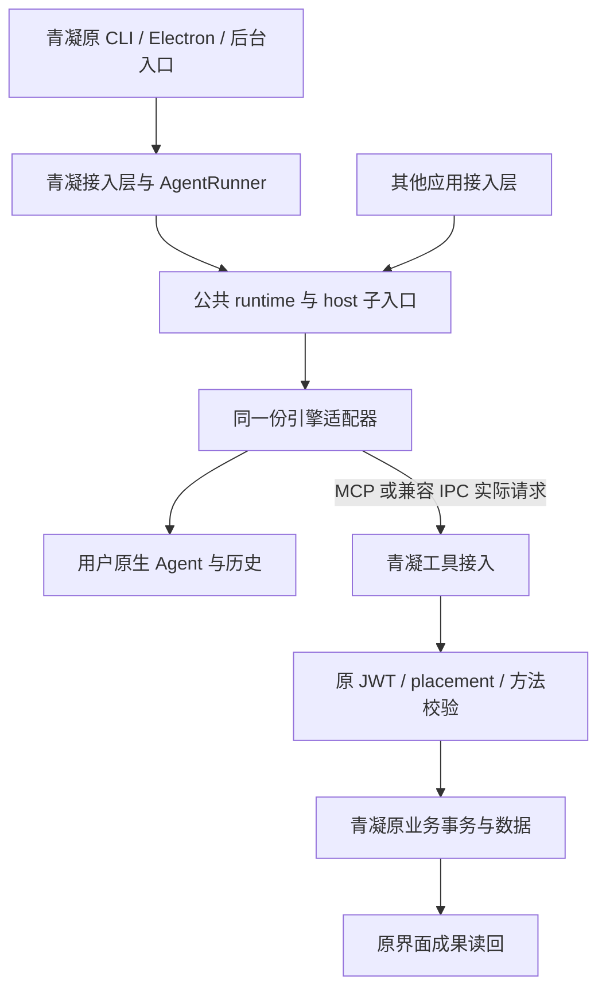

# 公共 SDK 最小接口与青凝接入层技术设计

日期：2026-11-13。版本：reference design draft 0.3。范围：Node/TypeScript 参考实现的接口、调用关系、代码归属及兼容设计；未开发、抽取或运行。

本设计是[接入规范](general-integration-contract.md)的一种参考实现，产品目标见 [SPEC](../SPEC.md)。独立实现无需采用本文函数签名、Node/TypeScript、包结构、`/host`、青凝业务模型或文件路径；规范中的义务及标准绑定才是符合性依据。A/B、本机/远端、授权、材料披露及写入防重要求均保留。

下述源码基线仍为 2026-11-12，2026-11-13 只调整文档分层、规范映射并同步三项通用运行规则的责任，没有重新取证源码或运行测试。原 SPEC/本设计旧评审仅覆盖各自旧版本，不能自动覆盖本修订；前轮记录见[规范补齐与独立评审](reviews/2026-11-13-normative-gap-review.md)，本轮通用运行规则见[独立评审记录](reviews/2026-11-13-runtime-rules-review.md)。

## 1 目标、基线与范围

可观察目标是：青凝的原任务入口通过公开 SDK 调用用户自有引擎，实际工具请求仍交给青凝原业务接口，成果由原应用读回；另一领域应用可通过同一公开接口提供自己的身份、材料和方法。

本轮源码基线为 `ResearchStudio/青凝bot` 的 HEAD `6f63102006dc7eca0a3ed845930f68f56cefe16a`。工作区有不相关的任务界面改动，未触碰；下列所核引擎、连接和身份文件按当前磁盘内容确认。CodeGraph 用于定位，过期索引的行号未直接沿用。完整源码路径相对青凝仓库；简写 `computer/` 与无目录的 engine/daemon/session 文件指 `server/src/agents/computer/`，`runtime/` 指 `server/src/agents/runtime/`，`agents/` 指 `server/src/agents/`。

只读源码与现有测试定义，没有读取真实凭证、运行模型、构建或执行项目测试。2026-11-04 的[抽取评估](extraction-assessment.md)保留为历史，本稿补充当前精确接口和调用点。

设计选择一个可版本化的 Node/TypeScript 参考 SDK，采用 ESM，沿用现有运行技术栈。一个包的主入口提供应用运行接口，`/host` 子入口提供确有青凝消费者的可信宿主能力；包名与支持的 Node 版本在发布前验证。本文中的类型是文档级接口形状，不是已存在的模块或可编译声明文件，也不规定其他语言实现必须使用 TypeScript。

首个公共核心不承担新的云端账号、任务数据库、全局会话库或共享 daemon 服务。用户机器连接、业务授权和原生历史继续由各自原 owner 承担；本轮只确定接点，不以运行库交付冒充完整连接产品。

## 2 依赖和唯一所有者



| 状态或决定 | 唯一负责方 |
| --- | --- |
| 任务何时发起、inbox/agenda、watermark、重投递、账本与 run 记录 | 青凝原 AgentRunner 和后端，不迁入 SDK |
| 当前应用/主体、placement、业务对象权限、业务防重与已提交结果 | 青凝原认证与业务 owner；其他应用提供自己的对应 owner |
| 一个已打开会话的原生进程、当前轮次、事件聚合与进程退出 | SDK runtime/driver；主轮次不再由另一份旧 adapter 并行执行 |
| 原生 transcript、登录与引擎配置 | 原生引擎和已有受控认证路径 |
| native session 指针及其应用命名空间 | 宿主提供的原 session store；SDK 使用该接点，不另建数据库 |
| 同一配置下 daemon 的安装、归属、自启、升级与回退 | 青凝既有 ownership/supervisor；SDK 不自动安装第二服务 |
| 用户界面接收、账号切换与最终展示 | 青凝原读权限、输出入口及 auth contextEpoch；SDK 输出不能绕过它们 |

SDK 不自动把最终文本保存为青凝消息。现有 Agent 可能已经通过业务工具提交回复，再执行一次 reply 会双发。最终内容只送到明确的内容消费者，业务写入仍通过真实工具请求发生一次。

## 3 主入口的最小接口

```typescript
// 文档级签名：参数中的逻辑类型在下表定义，不是新的网络报文。
declare function createRuntime(options: RuntimeOptions): AgentRuntime;

interface AgentRuntime {
  inspectAgents(access: AccessContext, input: InspectInput): Promise<AgentInventory>;
  openSession(access: AccessContext, input: OpenSessionInput): Promise<AgentSession>;
}

interface AgentSession {
  readonly ref: SessionRef;
  readonly openedAs: 'new' | 'resumed';
  startTurn(access: AccessContext, input: TurnInput,
            sink: OutputSink): Promise<AgentTurn>;
  close(access: AccessContext): Promise<CloseResult>;
}

interface AgentTurn {
  readonly ref: TurnRef;
  result(access: AccessContext): Promise<TurnResult>;
  respondToInteraction(access: AccessContext,
                       reply: InteractionReply): Promise<ReplyResult>;
  cancel(access: AccessContext): Promise<CancelResult>;
}

type OutputSink = (event: RuntimeEvent,
                   control: AgentTurn) => void | Promise<void>;
```

| 类型/操作 | 最少承载的数据和行为 |
| --- | --- |
| `RuntimeOptions` | 已安装且可信的 driver 集与宿主接点。无浏览器可填的任意命令、env、凭证文件或服务地址透传 |
| `AccessContext` | 每次调用由可信宿主认证得到的当前请求上下文；不是 caller 自填 userId 的 JSON，也不以 TypeScript 品牌类型充当安全证明 |
| `InspectInput` / `AgentInventory` | 宿主已配置的 Agent/profile 引用、安装/版本/检查来源与逐项能力。静态检查不发起推理，不把检测到程序当作请求已成功 |
| `OpenSessionInput` | Agent/profile 引用、应用工作范围引用、所需能力，以及明确的 `new` 或 `resume` 模式；resume 使用宿主持有的受范围约束引用 |
| `SessionRef` / `TurnRef` | 运行关联引用，不是授权或业务幂等凭据。进程内用句柄；网络公开 ID 必须由应用接入层重新认证和检查归属 |
| `TurnInput` | 用户任务、获准内容块/资源引用、所需能力；按规范第 5.1/7.2 节接入应用产出要求、可接受保证及可信运行限制。任务与材料分开，保留来源/完整性；逻辑要求不等于已冻结的供应商字段 |
| `OutputSink` | 发起前注册的可信宿主输出接点，接收事件及同一 AgentTurn 控制句柄；首个事件即可回复交互或取消，交付前检查内容、接收身份与材料许可 |
| `TurnResult` | 原生轮次终态、内容完整性、实际结构化保证/校验状态、运行限制及停止的实际观测、原生会话引用、真实模型/用量与失败原因。字段映射仍待实现设计，不由 SDK 猜测业务提交或费用硬封顶 |
| `InteractionReply` | 原 turn/request、经过验证的真人或当前有效策略决定及其来源，或上游允许的真实补充信息；按规范第 7.1 节保留必需人审。具体回复一次消费，策略/原生记忆仍归原 owner；不新增统一批准口令 |
| `CancelResult` / `CloseResult` | 请求被接受/不支持/已结束等实际控制结果，另报告原生停止确认或状态未知；不证明业务回滚 |

`openSession` 在产生原生执行效果前校验当前绑定与能力。指定 resume 但不存在、不可读、不兼容或无权时分别返回失败，不静默新建；宿主取得明确结果后另行选择新会话。`startTurn` 在同一会话忙时返回 busy，不在 SDK 建任务队列；青凝沿用原调度和排队策略。

`startTurn` 只等待当前轮次受理，不等待轮次完成。SDK 在 dispatch 前注册控制句柄和 sink；即使事件先于 `startTurn` Promise 的回调进入 sink，第二参数也已是可用的同一个 AgentTurn，之后 Promise 返回该对象。交互先登记为 pending 再投递事件，回复/取消不能被等待启动或 sink 完成所持有的主轮次锁阻塞。

`result(access)` 是带当前授权检查的读取方法，不暴露永久缓存原内容的公共 Promise 属性。等待结果中遇到注销、撤权或上下文变化时也须在返回前复核。对已经合法交付的内容不承诺远程收回，后续读取和新界面提交仍受当前权限约束。

主入口不提供任意终端执行、自由切换身份或全局 env 修改。绑定和 profile 变化产生不同会话范围，缓存按真实影响运行的配置隔离，不共享上一主体的目录、模型、认证或版本拒绝状态。

下列建议逻辑形状只展示已有内容/终态/连续性维度，不是完整冻结结果类型；新增保证、校验与限制维度必须按规范落实到公开绑定，不能因简例未列而省略，也不在本轮发明 Node 专有字段。结果示例如下，`ContentBlock`、`NativeFailure` 和 `ReportedUsage` 是实际标准/原生类型的投影别名，`ResumeRef` 是宿主持有并绑定范围的原生引用，不是新的网络 schema：

```typescript
interface TurnResult {
  execution: {
    state: 'completed' | 'failed' | 'cancelled' | 'interrupted';
    cause?: NativeFailure;
  };
  output: {
    completeness: 'complete' | 'partial' | 'unavailable';
    content: readonly ContentBlock[];
  };
  continuation:
    | { kind: 'unavailable' }
    | { kind: 'available'; ref: ResumeRef;
        persistence: 'saved' | 'not-configured' | 'save-failed' };
  usage?: ReportedUsage;
  model?: string;
  observationIssue?: ObservationFailure;
}
```

`output.completeness` 指聚合内容是否完整，不代表已经向所有订阅者送达；`observationIssue` 单独记录 sink/流交付问题。业务是否保存仍由原业务 owner 的回执和读回决定。已失权的 `result()` 调用拒绝返回内容，而不是返回带错误的私密 payload。原生会话是否支持 resume、native ref 是否已保存和历史是否能重放分别声明。

## 4 宿主接点和安全调用边界

宿主接点由可信代码在 `createRuntime` 时提供，不来自模型或网络字段。建议保留下面四个职责，物理函数名可以在实现时合并，不能合并权威来源。

| 接点（逻辑名） | 输入/返回与必须生效的检查 | 青凝提供者 |
| --- | --- | --- |
| `authorize` | 当前 AccessContext、动作及目标引用，返回当前授权绑定与失效通知；拒绝/异常时 fail closed。创建、恢复、发起、控制、交互答复、工具入站、结果读取和输出交付都受约束 | 原 device/Agent JWT、实时 placement 与业务作用域；外部用户请求仍由原后端认证 |
| `prepareSession` | 已授权的绑定与已选择 Agent，解析受控 home、原生 profile、策略、bootstrap 和工具连接引用。运行环境按实例构造，不修改 process.env | 原 Agent home、profile env、可信 shim、Claude/Codex 约束与青凝生成的业务指令 |
| `deliver` | 绑定、当前交付上下文和类型事件，经接收主体/材料范围检查后送交 OutputSink；长流有失效机制，旧上下文迟到更新被拒绝 | 原事件/内容消费入口和服务端读权限；前端再以已有 contextEpoch 防迟到界面提交 |
| `sessionRefs`（可选） | 在可信范围键下 load/save/clear 原生指针；区分 missing、unreadable、saved 和 save_failed。无存储接点时明确仅进程内连续 | 既有 EngineSessionStore 及其原目录映射，不能另写一份 session 库 |

授权接点不是新身份服务。青凝 daemon 的服务主体可用于生产和上报本 Agent 的运行信息，但不能替代最终人类读者的账号与会话权限；后端转发给浏览器时再次按原业务读取权限检查。仅在 UI 丢事件不足以阻止服务器向失权接收方继续输出。

接收者当前有权与材料获准向该接收者披露是两个条件。共享会话、历史、工具结果、最终文本和产物均按 SPEC 的范围规则处理；不能可靠约束混合来源输出的组合不声明通过。宿主可以采用授权范围相符的专属会话，不预设新增通用来源数据库。

SDK 保证每个 AgentSession 及其对应原生会话同一时刻只有一个活动轮次；隔离的多个会话可以并行，由青凝既有信号量、pacer 和宿主策略控制总量，不将整个 AgentRuntime 全局串行化。跨进程复用同一原生会话时，宿主必须先取得已有机制提供的有效排他执行权；青凝复用 daemon ownership，不在 SDK 新造分布式锁或服务注册中心。无法确认排他权的组合不得宣称支持并发恢复。

## 5 事件、结果与交互的具体语义

类型事件最小集合是：用户内容增量/结束、观察到的工具状态、交互请求、实际用量，以及轮次终态。它们是进程内消费投影，不另设一套竞争网络协议。真实 ACP/原生字段和错误保留在对应适配层，错误类别不充当未执行证明。

1. `OutputSink` 与其可用 AgentTurn 控制句柄在原生 dispatch 前安装，交互请求先登记再投递，避免首个批准请求到达时无处答复。主轮次和事件分配同一个稳定运行关联；用户内容只从原生用户可见 message/content 提取，不从截断 onLog 重拼全文，不把 reasoning 当兜底文本。
2. `startTurn` 只接受一次实际 dispatch。终态事件与 `result()` 从同一私有结算记录产生，完成/退出竞态只能结算一次；读取、重复查询、观察者退订或回调失败不能再次执行任务。
3. 终态区分原生 completed、failed、cancelled 与 interrupted/无法确认。completed 只是原生轮次完成，业务结果仍问原 owner。取消请求先返回接受状态，只有实际停止得到确认才宣称已停止。
4. 内容完整性显式为 complete、partial 或 unavailable。要求完整内容的组合在能力不足时不得启动并伪装成功；仅依赖业务工具提交成果的青凝兼容路径可单独声明其输出限制，不等于通用聊天 SDK 已完成。
5. 初版不建立持久事件回放库。runtime 存活期间可通过有权的 `result()` 取得已聚合结果；Web 重连、历史和持久成果由宿主既有 owner 提供，缺失片段不能称为已回放。输出结束消费不自动取消原生任务，取消使用显式控制操作。
6. 输出与诊断缓冲有明确字节/消息边界，实现前按现有场景核实参数。不能静默丢弃必要内容；缓冲、交付或观察故障单独报告，必要时请求原生停止并核对未知效果，不因输出失败重跑已经执行的业务。诊断回调不得改变工具提交事实。
7. 批准和补充信息是独立可选能力。请求绑定当前 turn、操作及允许的选项/schema；已消费、过期、取消、撤权或轮次结束后答复失效。有效用户策略可以在上游允许范围内自动处理许可，并保留其真实来源；必须当次人审或补充信息须用户审阅时不得策略代答。无有效决定时按声明等待/拒绝，不用自动 allow-once 冒充真人决定；具体接续见规范第 7.1 节。

原生会话指针保存失败与模型失败、输出失败分别报告。业务已经完成时，不因保存指针失败重新执行任务。原生执行结束信息只包含实际报告的模型和用量，缺少报告保持未知。

本轮通用义务的主入口接点还须在后续设计中明确：产出 schema/支持子集与原生或宿主校验的绑定；主轮次的可信时限/预算及计时范围；自动许可来源和等待策略。辅助调用已有 AbortSignal/超时不证明主入口已具备同等能力。实现可复用既有进程控制和 host 策略，不固定所有引擎同字段，不增加业务委托、账本或调度 owner。

## 6 同包 `/host` 的必要辅助接口

这些操作已有真实青凝消费者，保留它们是行为兼容要求；不要求普通接入应用或每个引擎都实现。它们调用同一 driver 和授权/进程控制机制，不另设 extension registry，也不允许青凝从包内部深导入旧实现。

| 接口（暂名） | 现有调用与最小契约 |
| --- | --- |
| `completeAuxiliary(access, input)` | 对应 `classify`，青凝分诊真实使用。input 必含宿主 AbortSignal，并受原宿主超时策略约束；另有独立 small-model/profile、工具受限的中立目录与自足 prompt。返回文本、真实用量/模型或错误，不混入主会话 persona/工具/上下文 |
| `checkHealth(access, input)` | 对应 doctor 的主/辅/wake 探测。input 必含宿主 AbortSignal，超时沿原受控设置；静态检查与明确同意的真实模型探测分开，保留诊断语义与成本说明，inspectAgents 不隐式发推理 |
| `steer(access, turn, input)` | 对应运行中同轮输入，返回 accepted/not-running/unsupported；必须绑定当前轮次，不能把某引擎的 no-op 当成功，不支持时由青凝沿原下一轮输入策略处理 |
| `createArgvBridge(options)` | 兼容现有 argv 文件传输，可信目录与 `invoke(argv, signal)` 回调由宿主提供。原子认领、拒链接、输入限额、取消和响应保护随机制一起抽取；它不执行任意 shell 命令 |

`seedHome` 不再成为接入应用必填的青凝 Persona 接口。宿主提供领域无关的 bootstrap 指令/受控文件，driver 保留非破坏性布局和安全写入机制；青凝业务文字、命令指南和品牌名称由青凝生成，原记忆文件不能被初始化覆盖。

辅助调用在开始前及等待资源期间检查 signal，并将停止/超时传至真实子进程。青凝整体 drain 先 abort 相应辅助操作，再等待原 activeTriage/doctor Promise 与子进程实际结束；关闭主 session 只关闭其受控会话，不代表全部辅助推理已停。超时值由既有受控策略提供，不在本稿另设无依据默认值。浏览器断开或观察者退订不直接等价为该取消信号，不得让主任务与分诊的停止语义因接口精简而丢失。

## 7 两条工具接入路径

**标准 MCP 路径：**可信宿主提供经过验证、从 Agent 所在位置可达的 MCP 连接引用；driver 按协商能力挂载。Agent 产生真正的 tools/call，MCP 服务按原身份执行一次并返回标准结果。SDK 的 tool-observed 事件只展示，不调用业务函数。参考 [ACP session setup](https://agentclientprotocol.com/protocol/v1/session-setup)、[ACP tool updates](https://agentclientprotocol.com/protocol/v1/tool-calls)及[MCP tools](https://modelcontextprotocol.io/specification/2026-07-28/server/tools)。

**青凝兼容路径：**原 `CUMORA_MCP_SHIM`/CLI codec → 提炼的 argv broker → 青凝 `invokeRuntimeCli` → 原 `/runtime/cli` → 真实主体和业务事务。固定 `cumora` 名称、命令 schema、旧脚本格式与服务地址/令牌处理留青凝，不能将它直接改名为完整公共 MCP server。

两条路径对同一次方法请求选择一个实际执行通道，不根据展示事件再执行第二次。方法参数不能改写可信身份、URL、令牌或重定向策略。

标准结果必须依据所选协议绑定保留全部所需语义，而非只保留 `content/structuredContent/isError`。MCP 2026-07-28 还须保留 `resultType`、`inputRequests/requestState` 及接续的 `inputResponses`；客户端原样保留接续状态，以新 RPC ID 继续原逻辑操作。现代版的请求 metadata 与旧版握手分别处理，具体规范见[标准绑定](general-integration-contract.md#8-哪些复用标准-哪些需要补充)。`requestState` 不自动承担业务防重或批准一次消费。声明的 schema 继续保留并校验。青凝现有 HTTP `ok/text/exitCode/sideEffects` 由青凝 codec 明确映射，SDK 传输不能只截取显示文本；既有旧消费者的文本兼容保留，但结构化能力必须经新旧链路协商与验收。工具回执是原应用结果，不是新的 SDK 提交证书。

## 8 青凝接入层的调用映射

青凝接入层是现有宿主职责的整理，不要求先创建一个新的“青凝适配服务”。建议在原 computer 目录形成一个清晰的宿主模块，由 AgentRunner 与 desktop-connect 调用，同一个公共包版本供原 CLI/Electron 构建使用。

| 当前调用点（源码基线行号） | 拟对接接口 | 保留在青凝的决定 |
| --- | --- | --- |
| `daemon.ts:1928–1950` 构造与 `2144–2169` start | host prepare + openSession / argv bridge | Agent/home/profile 映射、业务 bootstrap、清理遗留令牌与可信工具配置 |
| `2376–2399` ensureEngineSession、`2069–2119` runEngineAttempt | session/startTurn/result | standingPrompt/turnPrompt 的业务组装，实际任务关联与重试决策 |
| `2481–2637` inboxTriage，`2506` classify | `/host.completeAuxiliary` | 分诊提示、规则、背压、费用目的与处理结果 |
| `2911–3013` agenda、`3124–3467` runTurn/streamLoop | 同一 session 的主轮次操作 | inbox/agenda/wake、排队、watermark、已读与重投递 |
| `3098,3109` 原 steer | `/host.steer` | 不支持时的下一轮 coalescing 与业务响应方式 |
| `1973–1989` onEngineHop 与原 run 上报 | SDK 实际用量/终态 → 原上报 | ledger、run heartbeat/finish、业务目标是否完成 |
| `2205–2232` beginStop/stop | cancel/close + 原宿主 drain | 停止新工作、等待 triage、flush 原账本/指针，旧 runner 结束后才替换 |
| `desktop-connect.ts:41–184`、CLI doctor | inspectAgents + `/host.checkHealth` | company/session admission、配对、自启、registry 权威读回、默认引擎事务 |
| `daemon.ts:2270–2321` 身份与 HTTP 工具调用 | broker 的可信 invoke 回调 | JWT 缓存刷新、原服务器与参数身份注入、结构化结果 codec |

daemon 内的主运行、分类、探测与同轮输入全部切到该包的正式入口；不得留另一份 engine 只服务分诊，也不得长期通过源码相对路径导入包的 private 文件。当前注册的其余引擎不能因首个公共支持组合较小而从青凝静默移除；需逐个保留原能力和显式限制，其公共支持状态单独验收。

## 9 抽取、保留和新增清单

按符号和职责划分，不整文件机械搬迁。拟文件位置仅表示包内逻辑边界，不提前创建源文件或多个包。

| 当前来源 | 公共部分 | 青凝保留部分 / 处理分类 |
| --- | --- | --- |
| `computer/engine.ts` 进程、解析、错误与原生 adapter/session | 同包 driver、进程树控制、参数化运行与能力元信息 | Persona header/业务命令说明移入青凝 bootstrap；安全 flags、白名单、固定可信 helper 不能删除。既有机制抽取与配置解耦 |
| `engine.ts` 的 classify/probe/probeWake/steer/seedHome | `/host` 辅助机制与 driver 内布局，复用同一实现 | 分诊/诊断入口及领域内容留宿主，不另复制实现 |
| `computer/cli-version.ts`、`model-catalog.ts`、`claude-user-settings.ts` | driver 需要的版本/模型目录和安全配置投影 | 品牌提示、选择 UI 与原业务数据留青凝；缓存按实际 profile/运行作用域隔离 |
| `agents/text-safety.ts` 的被引擎使用部分 | 最少必要的文本安全辅助，随原引擎消费者抽取 | 若其他业务仍有调用，先做反向扫描并通过公共入口复用，不能复制两份或删除原业务使用 |
| `computer/codex-runtime.ts` 及会话迁移 | 原生配置/认证访问与受控运行机制参数化 | `.cumora` 路径、登录命令文案和历史迁移入口由青凝配置，保留原身份与历史，不改名迁移凭证 |
| `computer/session-store.ts` | 原子指针存取机制可作为可选 host 存储实现 | 原路径/范围键与 legacy quarantine 兼容策略由青凝选择；错误透明是新增行为，不能继续把失败返回成成功 |
| `computer/session-recovery.ts`、daemon fallback、`engine.ts:3350–3374` ACP handshake | driver 返回可信未开始/缺失/未知证据；严格 resume 失败贯穿到原生握手 | 高层业务重试策略留青凝，SDK 默认不重发；现有 ACP 缺失后直接 session/new 的回退必须改为显式失败/宿主决定，不能只改外层 helper |
| `daemon.ts:1378–1548` RuntimeCliBroker | `/host` argv 传输机制与完整安全约束 | invoke 回调、业务 codec、服务端令牌与真实方法不迁入核心 |
| `daemon.ts:1289–1360` MCP shim 与 writeShim | 必要的通用私有文件写入机制可复用 | 固定 cumora/cli(argv)、脚本文案和兼容 codec 留青凝；不当作标准 MCP 实现发布 |
| `daemon.ts` AgentRunner/triage/inbox/agenda/run/usage | 调用 SDK 的接点，不抽业务循环 | 留原宿主及原后端，继续持有调度、watermark、重投递与账本 |
| registry、runtime/server、authorization、cli-argv、业务 cli/task-scope | 不抽取业务授权/事务 | 保留 device/Agent JWT、实时 placement、不可伪造进程内任务 scope、业务防重与结果读回 |
| computer-config、provider-profiles、daemon-ownership、control-bus/event、model-id、kimi-thinking | 暂不作为公共核心抽取目标 | 保留原配置/凭证 owner、服务/控制流与业务设置准入；仅向 driver 提供经过验证的实例配置 |
| agent-cli、server cli-bin、Electron、prepare-desktop-cli、UI stores | 同一公共依赖进入原构建 | 保留原别名、可信 IPC/Node/CLI、自启/更新渠道、Computer 读回和界面；不另起安装器或 daemon |
| 当前公共接口缺失的能力 | 完整内容与类型事件、交互答复、通用 MCP 注入、结构化结果保真、指针错误报告、实例配置作用域 | 明确为新增/通用化行为，逐组合验收，不能声称纯抽取已经提供 |

公共依赖闭包不能导入青凝任务指南、inbox、SQL/Redis、组织/成员对象或原认证服务实现。应用方法通过受控通道调用原服务，不通过把业务源码打包进公共核心完成“独立”。

## 10 失败、恢复与重投递设计

SDK 不以 error 字符串、无 usage 或进程已死推定业务未执行。driver 可报告原生握手/提交阶段的可信证据：尚未接受、已经接受或未知；不支持确认时使用未知。原生错误类别用于诊断，不直接授予自动重试权。

当前 `daemon.ts:2087–2102` 仍有基于无 usage 的 persistent→one-shot fallback；`3431–3436` 失败不 ackSeen，`3465–3467` 重连 catch-up 会重读工作。这意味着重试边界不只在 SDK，青凝业务调度也必须处理未知效果。

原生 driver 内也有恢复语义：`engine.ts:3350–3374` 的 ACP handshake 在匹配缺失会话响应后清 sid 并调用 session/new，`3545–3546` 只日志提示。本设计的严格 resume 必须改变这一内部回退路径，返回真实恢复失败，再由青凝决定是否另建与重发；不能外层宣称严格恢复，内部却已经换了会话。这是需要改造的当前行为，本轮未改代码。

| 场景 | SDK 行为 | 青凝宿主和原业务 owner 的行为 |
| --- | --- | --- |
| 所需能力/授权不成立，原生尚未开始 | 拒绝并报告依据 | 保留任务，提示可执行的处理，不以宽权限继续 |
| 明确未接受轮次或原生 resume 缺失 | 返回可信阶段/恢复失败，不静默新建或重发 | 按原生证据与业务要求决定是否新建后再次发起，保持同一业务关联；不能只匹配诊断文字 |
| 已接受或阶段未知，完成事件丢失 | interrupted/unknown，不自动 fallback | 先读原业务效果或按已验证稳定关联/原生约束准入；不能因未 ack 或再次读到 inbox 就盲重投 |
| 原生完成，session 指针保存失败 | 执行与 save_failed 分开返回 | 不重跑已完成业务；说明下次连续性未持久，保留原成果 |
| 输出交付失败或用户切换账号 | 拒绝失权交付，报告交付状态，保留必要运行事实 | 原业务成果与恢复归原 owner；不能把迟到内容交给新账号，也不因看不到内容再执行写入 |
| 请求取消/撤权 | 停止新授权动作和输出，按实际能力请求停止原生执行 | 检查在途与已提交效果，不宣称撤销等于回滚 |

写方法按[规范第 4 节](general-integration-contract.md#4-应用提供什么方法)选择原业务约束或可信业务关联，并填写实际载体、模型外注入与执行端验证、原子性、保留/过期和核对入口；A/B 与新 RPC ID 的重发都适用。SDK 不替普通外部宿主自动创造该能力，未满足的创建类方法必须拒绝。不能在 SDK 新建一个 competing operation 表，也不能由模型生成或丢失后换新业务键。队列重新发现同一工作、业务重试与用户明确发起新任务分别处理。

在“工具已执行、完成/usage 未返回即断线、daemon 重连或重启”的反例通过前，不能将运行库的 retry helper 测试写成青凝完整写入安全证明。现有源码条件已确认，真实重复效果未在本轮复现；本轮不修改现用重试行为。

## 11 本机、远端和 B 的技术接点

同一 Node SDK 在实际执行机器的可信宿主中运行。青凝现有 device 配对、出站 HTTP/SSE、短期 Agent JWT 和后端方法链路继续承载青凝场景；远端受控机器可用同类部署，但按实际平台/交互组合验收。

新 Web 应用不能只在云端导入 SDK 就连接用户电脑。其连接层需提供真实的逐应用/用户授权、运行身份和工具反向路径；本设计保留该接点，不把青凝 company 永久配对码改名为通用 grant，也不在这一阶段新增共享连接服务。任意远端 Agent URL 仍需已验证协议适配器，不能把控制通道和应用方法可达性混为一件事。

B 使用原宿主到应用受保护 MCP 服务的路径，原宿主控制会话；应用继续检查自己的方法、结果与授权。B 不需要创建 SDK session、登记宿主机器或把整个原对话交给青凝。青凝当前品牌 shim 不能单独证明完整 B 互通，B 的服务出口需按现有协议与本项目规则单独验收。

## 12 后续实施顺序、兼容与退出门

这是供后续实施使用的设计顺序，本轮不执行代码任务。保持一个能力路径在推进，允许在相同接口与 owner 下并行检查，不按文件数或接口数报告产品完成。

1. 先固定真实内容消费者、工具实际执行通道、宿主访问控制和未知效果重投递依据。复现或排除上述高风险反例，区分等价抽取与新增行为。
2. 将公共依赖闭包移入一个可版本化依赖，青凝通过主入口和 `/host` 使用同一实现；保持原配置、session、登录、设备和服务归属。不得长期保留第二份引擎或私有深导入。
3. 接通青凝原入口到原业务成果读回，验证主任务、分类、doctor、steer、停止与重建，逐个保留现有引擎的真实能力和限制。新内容/交互能力单独验证。
4. 第二领域应用只通过同一公开入口和自己的业务方法完成路径。示例可以证明接口可用，不能冒充外部需求；消费者尚未落实时不先扩建无人使用的授权/队列平台。

保留现有 `.cumora`、profile、原生认证/会话和安装入口；青凝锁定组件版本并记录 CLI/应用/driver 的对应关系。升级先 drain 原 runner、控制新工作并核对在途效果，再替换同一受控产物；回退同样禁止新旧版本争抢状态或重放未知任务。首步无持久布局迁移；后来若需改变格式，必须明确旧版兼容、转换、在途处理和回退门，不能仅凭回退二进制推定数据兼容。

完整退出门是原界面能读回真实成果，受影响安全负例与连续使用通过，且主运行及辅助操作都来自同一包。涉及权限、凭证、跨层状态与业务效果，沿相应中高风险边界验证，不以文档类型或纯对象测试代替真实路径。

| 验证面 | 可复用的原测试资产与必要补充 |
| --- | --- |
| 引擎安全、内容/事件、终态/退出、分类/探测 | `agents-computer-engine.test.ts`、`agents-computer-engine-failure.test.ts`、各引擎/provider 测试；补完整用户内容与 reasoning 分离、交互过期/拒绝、结果与唯一终态一致 |
| session 指针/停止/切换 | session-store/recovery、engine-hot-switch、provider-profiles；补不可读/保存失败不冒充 missing 或触发业务重跑、ACP 严格 resume 不内层新建 |
| 真实工具与结果 | `agent-computer-shim-output.test.ts`、`agents-runtime-cli-argv.test.ts`、runtime integration；保留原子 claim/拒链接/并发/取消，补结果保真与通知不执行、内容不再次 reply |
| 重投递/未知效果 | inbox-drain-watermark、fallback-poll、session-recovery 与真实业务 integration；补已经提交但完成/usage 丢失，含重连、重启和新 RPC ID |
| 身份/输出/材料边界 | 原 runtime/placement integration、客户端 contextEpoch；补账号/工作范围切换、长流失权、缓存/产物/历史读取、混合来源输出与合法跨服务任务 |
| 控制时序与并行 | 原主/辅/stop/triage 测试；补首次事件即要求批准时句柄可用、多隔离会话并行但同会话 busy、停止宿主时独立辅助进程实际退出 |
| 交付与回退 | qingning-entry-compat、Electron/connect、desktop/computer/ownership integration；按原生平台核查同实例替换、旧身份/历史保留和失败切回 |

测试简写在青凝 `server/src/__tests__/`，integration 位于 `server/src/__integration__/`，Electron 前端测试在 `tests/`。本轮只核查测试定义，不报告它们已在当前版本运行通过。

## 13 当前源码证据与摘要

关键源码定位：`engine.ts:552–583,683–698,792–871` 为当前接口；`1426–1500,2205–2214,3704–3708` 为内容解析与截断/私有出口；`3540,3851–3905` 为 ACP MCP 空配置与 DSH 权限差异；`session-store.ts:39–62` 为读取/保存错误处理。

青凝原身份与效果检查位于 `runtime/server.ts:80–117,152–187`、`runtime/authorization.ts:23–48`、`agents/cli.ts:2439`；回执为 `agents/cli-result.ts:20–21`。客户端既有新鲜度来源为 `src/stores/auth.ts:39–46`。不是只依赖调用方填写范围或界面过滤。

本表保存当前取证涉及的关键文件摘要，后续源码变更须重新核对受影响边界，不能只沿用历史行号。

| 文件 | SHA-256 |
| --- | --- |
| `server/src/agents/computer/engine.ts` | `05f1a68da28a0df62e8ba6a2e5ee0df5d448fd0aaa31e1d09b7e3587d61d1372` |
| `server/src/agents/computer/daemon.ts` | `6badcfad0df3939aeea67bc8c28fae464dcbb0f94e544ad463bdaeb01e5a155c` |
| `server/src/agents/computer/session-store.ts` | `40d547f52b543d6f78338f8961449a2bf7ce79033be00e561b65a820877e0e81` |
| `server/src/agents/computer/session-recovery.ts` | `d1ad7de23351bebc0f08b5ac0706f50ea15f0cbd0f084e86d171da9e34a3a84a` |
| `server/src/agents/computer/codex-runtime.ts` | `d08c61289e6b3b429c76aac23b49b77b1b9e99b89721af0615aa411f8d574e4d` |
| `server/src/agents/computer/desktop-connect.ts` | `8222cd05ba90f642b88139582e97121218c32ec35fab3521480abbdaafdb2c7e` |
| `server/src/agents/computer/computer-config.ts` | `bb01509384aad13f104003364cd1ba2484b66f97325c6b3c43e749fefe272071` |
| `server/src/agents/computer/daemon-ownership.ts` | `f637cef34e3e923958c2b434e06d07d5f4f3d552abe3d9f6d924198715708a13` |
| `server/src/agents/runtime/server.ts` | `2f59eb4002c688757c82afcdccbf29d6dd2a9ab1bbe235aef491ab941238661a` |
| `server/src/agents/runtime/authorization.ts` | `c17879832a8cff003430c92f3879666337b64c7fd6b8a1725a6bc94deb2dcd04` |
| `server/src/agents/cli-result.ts` | `5b9fb0286b05906ec44fcee18c65d3e31502b62a596e7e3247d0eb302df65a82` |
| `agent-cli/src/cli.ts` | `ffa96efdbe13b1fbab30d8760825ef6b02ff647e113821ae05841ade415467a4` |
| `agent-cli/build.mjs` | `168446ac0281dd43def53ce479fd890a1beff45be2a252894e58efa693a2e497` |

## 14 设计复核与尚未交付项

本节前三项问题及其源码摘要检查是 2026-11-12 对 reference design draft 0.1 的历史复核，不是本轮修订的评审或源码重验；本轮结论集中在 2026-11-13 记录。

运行接口与青凝宿主两个角色分别只读取证并核对设计，主 Agent 统一编写。独立裁判对照当时已审 SPEC、源码和调用反例审查，确认下面 3 项 P2 接口/生命周期问题。修订后裁判定向复核确认三项全部关闭，当时技术设计稿未发现剩余实质问题；不沿用 SPEC 旧评审作为本设计通过证明。

| 设计复核问题 | 原反例 | 修订 |
| --- | --- | --- |
| D1：并发粒度 | 一个 runtime 可打开多个独立 session，原“实例内单轮次”可能错误串行化青凝多 runner | 明确同一 session/native 会话单活动轮次，不同隔离会话可在原宿主背压下并行 |
| D2：独立辅助操作的取消与 drain | 关闭主 session 不会自动终止尚在执行的分诊或 doctor，旧 runner 替换后可能遗留辅助进程 | 两辅助 input 明确 AbortSignal 和原超时策略，宿主先取消再等待 activeTriage/doctor 实际结束 |
| D3：首个交互的控制句柄 | 批准事件可能早于 startTurn Promise 返回，sink 没有答复句柄而启动又在等待批准 | OutputSink 同时收到预注册的同一 AgentTurn；pending 请求先登记，答复/取消不被等待启动或 sink 的控制锁阻塞 |

另补齐严格 resume 的 driver 落点：ACP 内层 session/new 回退列入改造和验收，不能只修改外层 helper。上述发现均是设计精确性问题，不表示本轮复现了运行故障。

关闭依据为每会话并行边界、辅助操作取消/drain、首个交互控制句柄均已有具体接口和时序约束，且没有破坏授权、输出、唯一结算、工具执行、宿主重投递及兼容回退规则。文档链接与标题锚点检查通过，13 个关键源码摘要复核一致；已审 SPEC 和详细接入约定内容保持不变，本设计没有替它们放宽目标。

包名、具体最小支持组合和 Node 运行版本尚未冻结，第二真实消费者未落实。完整内容、交互、MCP 注入及结构化回执属于新行为；任何未通过的组合仍标明未支持。运行库、部署连接产品与 B 互通各自验收，并按规范第 11–14 节提供能力绑定、连接安全、诊断隐私及独立接入证据。两应用同 SDK 只证明实现复用，不将本文存在视为代码交付或规范独立互通。

下一项具体工作是在同一青凝实际任务路径上验证已执行工具但完成信息丢失时，原业务核对/防重与宿主重投递怎样衔接，再按上述接口与代码归属确定第一项可执行抽取。当前继续先不开发。

## 15 2026-11-02 历史来源基线

以下内容从旧详细接入约定原样迁入，保留来源日期、版本、能力差异和未验证范围；不是 2026-11-13 当前源码复验，也不是其他实现须采用的规范。新的源码映射仍见本文第 8–13 节。


核查基线为青凝仓库 HEAD `3c2db3bb`，核查日为 2026-11-02。表中路径相对青凝仓库根目录，是来源定位，不是未来项目的目录依赖。CodeGraph 的相关引擎、daemon 索引过期，关键位置已按当前源码核对。

这些证据证明现有实现及其边界。本轮没有调用真实模型、复验当前部署或验证跨应用接入；工作区其他现存修改也不属于本次协议整理。

| 编号 | 当前源码位置 | 已有事实 | 通用化时需要注意 |
| --- | --- | --- | --- |
| S1 | `server/src/agents/computer/daemon.ts:502–537,2663–2720` | 应用取得 inbox 消息与附件元信息，再组装有限长度的上下文摘要 | 当前是业务消息摘要，不是通用资源目录；附件 URL 不等于已经读取正文，正文和列表都可能截断 |
| S2 | `server/src/agents/computer/engine.ts:552–583,683–698,792–860`；`server/src/agents/computer/daemon.ts:2375–2401` | 已有引擎适配、工作区、提示、模型、会话恢复、日志、用量、停止等公共接口 | 这些是进程内接口；公共结果没有统一最终内容字段，日志也不是完整的带类型事件流。不能把 env 原样开放成应用可任意传入的网络字段 |
| S3 | `server/src/agents/computer/daemon.ts:1288–1359` | MCP server 暴露 `cli` 工具，接收 `{argv:string[]}`，返回文本内容和 `isError` | 目前没有资源、提示模板出口或结构化工具结果；业务命令词仍绑定青凝。版本应答不能证明已兼容所有 MCP 版本 |
| S4 | `server/src/agents/computer/engine.ts:1600–1625,1995–2001` | Claude、Codex 的安全配置接入固定 MCP 工具桥 | 业务调用复用同一桥；各引擎的原生执行权限仍需独立约束 |
| S5 | `server/src/agents/computer/engine.ts:3068–3070,3524–3553,3608–3614,3713–3723,3834–3870` | DSH 通过 ACP stdio 执行，并保留 Harness 的原生认证与会话所有权 | 当前 `mcpServers:[]`，业务操作走兼容 CLI 路径；要求显式 unsandboxed，权限请求自动选择 allow-once。不能写成已通过 ACP 注入应用 MCP、逐次 UI 批准，或已具备与其他引擎相同的隔离和中途输入能力 |
| S6 | `server/src/agents/computer/daemon.ts:1214–1280,1377–1540,2290–2320` | 工具请求经文件 IPC 送到 daemon；daemon 持有身份、URL、令牌并转发 `{argv}` | IPC 随机编号只用于请求响应匹配，没有成为服务端业务幂等键；超时或取消请求不证明业务未提交 |
| S7 | `server/src/agents/runtime/server.ts:80–127,177–187`；`runtime/cli-argv.ts:19–42`；`cli-result.ts:12–21` | 服务器校验身份，将身份绑定到业务调用，返回 `{ok,text,exitCode,sideEffects}` | daemon broker 当前只保留 `text/exitCode`，MCP 再输出文本；不能声称业务副作用回执已贯穿所有桥接，也没有通用跨重启回执查询能力 |
| S8 | `server/src/agents/runtime/task-commands.ts:7–66`；`runtime/task-scope.ts:1–20`；`cli.ts:6809–6815` | 受限任务有方法目录、参数 schema、结果 schema 声明和逐次作用域检查 | 结果 schema 目前较粗。TaskCommandScope 是服务端进程内 WeakMap 绑定，不是可经 JSON 或 JWT 制造的凭证；不能与普通 BYOA 路由合并权限 |
| S9 | `server/src/agents/cli.ts:2380–2386,2506–2572,2619–2635` | 回复业务在应用事务中检查授权、提交消息与事件，成功后返回 message.posted 等效果信息 | 消息、参与者、公司与任务规则留在青凝；不要求其他应用照搬这些表和事件名称 |

现有实践提供了应用选择上下文、方法描述、受控调用、真实执行和回执的基础。需要补充的是通用承载与一致语义，不应因此把现有能力重新表述为尚未实现。


## 16 规范义务到参考实现的映射

| 规范义务 | 参考实现接点与待验证范围 |
| --- | --- |
| 通用基线与 A 运行角色 | 主入口、driver、authorize/deliver、会话绑定；名字与物理组织只属于本实现 |
| B 与标准工具语义 | 原应用 MCP 服务或已记录兼容路径；现代 MCP 多轮接续和原身份由实际客户端/服务端承担，不能从 tool-observed 事件再执行 |
| 写入意图、防重与未知效果 | 宿主可信入口及原业务 owner 按规范第 4 节提供绑定；runtime 不新增操作库、不生成替代键 |
| 连接与撤权 | 青凝已有身份/设备机制；其他应用选择自己的符合规范连接层，具体组合仍未验证 |
| 诊断和临时数据 | sink/缓冲、argv broker 与宿主原诊断 owner 按规范第 13 节落实；受控清理不删除业务防重记录和原生历史 |
| 符合性与独立实现 | 既有测试资产按规范第 14 节映射；独立接入可使用其他实现，不能以本 SDK 的内部测试代替 |

上述是待实现和验证的责任映射，没有新增可运行模块、schema 文件或软件包。

本轮 reference design draft 0.3 仅同步对规范第 5.1、7.1、7.2 节的责任映射；没有完成具体 API 字段、引擎绑定或实现开发。ServerAgent 的维护委托、候选启用和整体维护预算未迁入 SDK。
